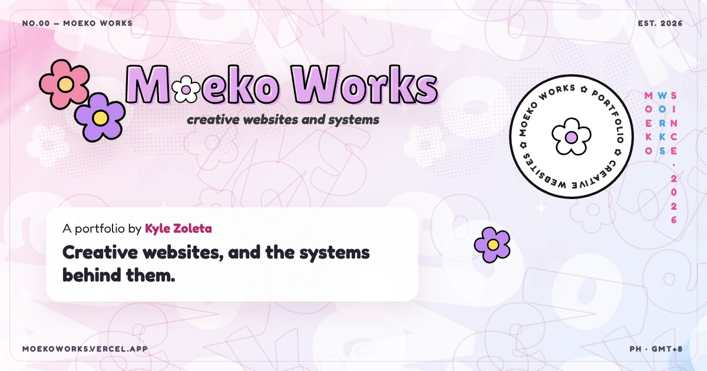
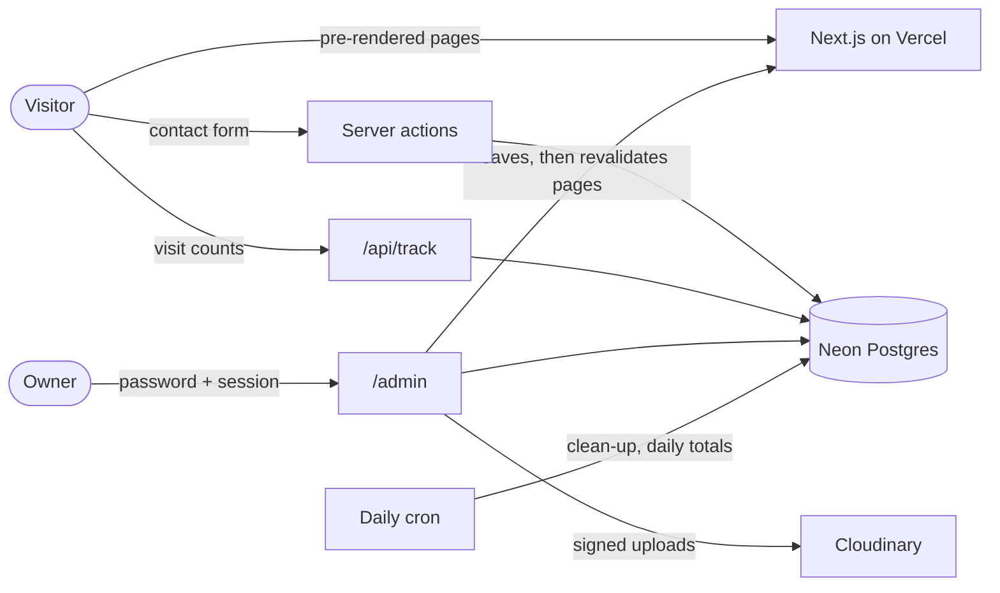

<div align="center">

<a href="https://moekoworks.vercel.app">
  
</a>

# Moeko Works

**A portfolio by Kyle Zoleta: creative websites, and the systems behind them.** 🌸

[](https://moekoworks.vercel.app)
[](https://moekoworks.vercel.app)

[](https://nextjs.org)
[](https://react.dev)
[](https://www.typescriptlang.org)
[](https://mui.com)
[](https://neon.tech)
[](LICENSE)

[**Visit the portfolio**](https://moekoworks.vercel.app) ·
[What's inside](#whats-inside) ·
[Tech stack](#tech-stack) ·
[Run it locally](#run-it-locally) ·
[Contact](#contact)

</div>

---

## About

**Moeko Works** is where I keep the websites I make and the systems behind them: the public pages people see, and the
admin panels, databases and analytics that keep them running. Each project gets a full case study, from the idea to
the parts visitors never see.

The design, **"Bloom Expo"**, is a bright paper-and-flowers exhibition: sticker headings, flower badges, a soft
patterned backdrop, and motion that can be switched off at any time.

## What's inside

### The portfolio

| Page                                                     | What it shows                                                                                    |
| -------------------------------------------------------- | ------------------------------------------------------------------------------------------------ |
| [**Home**](https://moekoworks.vercel.app)                | Works, the toolbox, certifications and news                                                      |
| [**History**](https://moekoworks.vercel.app/history)     | Every project, each with its own case study: preview video, gallery, links, tech and the admin side |
| [**About**](https://moekoworks.vercel.app/about)         | Profile and what I make: creative websites, the backends behind them, and more                   |
| [**Contact**](https://moekoworks.vercel.app/contact)     | A message form that goes straight to the admin inbox                                             |
| [**Privacy**](https://moekoworks.vercel.app/privacy)     | What's collected and why (very little)                                                           |

Projects featured so far include the [Kotoha](https://github.com/PastelSalt/kotoha-fansite) and Hanon fan sites,
Himawari, the [Aqua Iro Archive](https://github.com/PastelSalt/aqua-iro-archive), and this portfolio itself.

### The admin panel

An unlinked, unindexed `/admin` for the owner: projects (with media, links, tech and drafts), certifications, the tech
list, contact messages, visitor statistics, an activity log, an archive for anything deleted, and account settings.

### Built to be careful

- **Privacy-friendly visitor counting.** Cookieless, with a hash that changes every day and IP addresses never stored.
  A browser can opt out of being counted.
- **A contact form that resists spam** without a CAPTCHA: a honeypot, a signed minimum fill time, and a limit of five
  messages an hour per visitor.
- **Safe sign-in.** Argon2id password hashing, a forced password change on first sign-in, and 15-minute lockouts after
  repeated failures.
- **Nothing is lost.** Deleting moves things to an archive, where they can be restored.

## Tech stack

| Layer      | Choice                                                                                                   |
| ---------- | -------------------------------------------------------------------------------------------------------- |
| Framework  | [Next.js 16](https://nextjs.org) (App Router, pre-rendered pages revalidated after admin saves), React 19 |
| Language   | TypeScript                                                                                               |
| UI         | [MUI 9](https://mui.com) (Emotion) with CSS design tokens and cascade layers; [Lucide](https://lucide.dev) and Simple Icons |
| Motion     | [GSAP](https://gsap.com), [Lenis](https://lenis.darkroom.engineering) smooth scrolling, canvas-confetti  |
| Data       | [Neon](https://neon.tech) Postgres with [Drizzle ORM](https://orm.drizzle.team), validated with Zod       |
| Media      | [Cloudinary](https://cloudinary.com) (signed uploads, optimised delivery)                                 |
| Hosting    | [Vercel](https://vercel.com) (region `sin1`) with a daily cron for clean-up and visitor totals            |



## Run it locally

**Requirements:** Node.js 24 or newer, and a Neon (or any Postgres) database.

```bash
git clone https://github.com/PastelSalt/moekoworks_official.git
cd moekoworks_official
npm install
cp .env.example .env.local   # fill in the values; never commit this file
npm run db:migrate
npm run admin:seed           # creates the owner; the password must be changed at first sign-in
npm run dev                  # http://localhost:3000 (admin at /admin)
```

<details>
<summary><b>All scripts</b></summary>

| Command                         | What it does                                                         |
| ------------------------------- | -------------------------------------------------------------------- |
| `npm run dev` / `build` / `start` | Next.js development server, production build, production server     |
| `npm run lint` / `typecheck`    | ESLint and the TypeScript compiler                                   |
| `npm run db:generate` / `db:migrate` | Drizzle migrations (`drizzle/`)                                  |
| `npm run admin:seed`            | Create the owner account from `.env.local` (local only)              |
| `npm run seed:tech`             | Seed the technology list                                             |
| `npm run seed:<project>`        | Seed one project's case study: `kotoha`, `hanon`, `himawari`, `aqua`, `moekoworks` |

</details>

## Project structure

```text
src/
├── app/          # routes: (site) for the public pages, admin/ for the panel, api/ for tracking and the cron
├── components/   # site, projects, contact, decoration and admin components
├── server/       # database, auth, server actions, admin queries
├── lib/          # shared helpers, site configuration, the visit tracker
├── theme/        # design tokens and the MUI theme
└── styles/       # page and component styles
drizzle/          # SQL migrations
scripts/          # seeds, media capture and encoding, performance benchmarks
docs/             # the new-project playbook; plans/ holds the original plan and progress log
```

Adding a project to the portfolio follows [docs/NEW-PROJECT-PLAYBOOK.md](docs/NEW-PROJECT-PLAYBOOK.md): intake,
capture, admin screenshots, upload, seed, verify, ship.

## Contact

- **Through the site:** [moekoworks.vercel.app/contact](https://moekoworks.vercel.app/contact)
- **GitHub:** [@PastelSalt](https://github.com/PastelSalt)
- **Security problems:** please report privately, see [SECURITY.md](SECURITY.md).

## License

**All rights reserved.** This repository is public so you can read how the site is built, but the code, the
**Moeko Works** name and logo, the writing, and the screenshots and media are not licensed for reuse. See
[LICENSE](LICENSE). The projects shown keep their own licenses; the fan sites credit the owners of their content.

<div align="center">
<br>
<sub>Made with 🌸 in the Philippines · © 2026 Moeko Works</sub>
</div>
