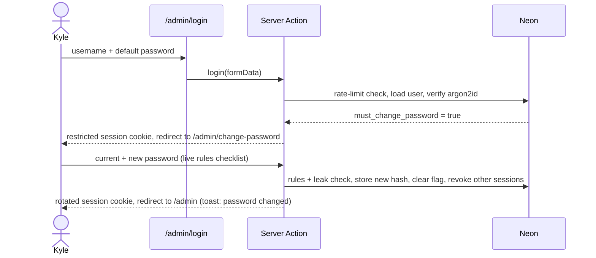
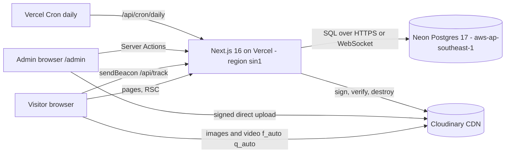

# Moeko Works Official Website — Preliminary Plan

> **Moeko Works** — a portfolio by **Kyle Zoleta**
> ⚠️ **Renamed 2026-10-20:** the brand was renamed to **Moeko Works** (the old name belongs to an established company). Brand text in this plan was updated; infrastructure names quoted below (repo, Neon/Vercel projects, Cloudinary folder, DB roles) are the ones created at the time — see `docs/plans/PROGRESS.md` → "Incident log".
> File: `docs/plans/PRELIMENARYPLAN.md` · Version **0.3** · Updated **2026-10-04** (Asia/Manila)
> Status: **Ready to start** once the 4 start-up items in [§26](#26-readiness--start-up-items) are done
> Plan readiness: v0.1 61.1 → v0.2 80.0 → **v0.3 94.5 / 100** · **96.7 after the start-up items** · the last points come from your copy review at the design checkpoint ✋

**How to read this.** §0 lists what changed and our working rules. §1 is the summary. §2 covers the research and references. §3–§9 are product and design, §10–§13 the admin, §14–§20 engineering, §21 the Kotoha seed, §22 the roadmap, §23 risks, §24 decisions, §25 the evaluation and §26 readiness.

**Legend.** ✅ decided · 🟡 needs your review · ❌ missing · ⚠️ attention · 🔒 security-sensitive · ✋ checkpoint where you review

---

## Table of contents

0. [What changed in v0.3 & working agreement](#0-what-changed-in-v03--working-agreement)
1. [Executive summary](#1-executive-summary)
2. [Research & inputs](#2-research--inputs)
3. [Goals, audience & scope](#3-goals-audience--scope)
4. [Brand & content](#4-brand--content)
5. [Information architecture](#5-information-architecture)
6. [Visual design system](#6-visual-design-system)
7. [Motion & interaction system](#7-motion--interaction-system)
8. [Public pages — specifications](#8-public-pages--specifications)
9. [Project page template ("the boilerplate")](#9-project-page-template-the-boilerplate)
10. [Admin — shell, authentication & security](#10-admin--shell-authentication--security)
11. [Admin — Project History (inputs)](#11-admin--project-history-inputs)
12. [Admin — Statistics](#12-admin--statistics)
13. [Admin — Messages](#13-admin--messages)
14. [Technical architecture](#14-technical-architecture)
15. [Data model (PostgreSQL)](#15-data-model-postgresql)
16. [Media pipeline (Cloudinary)](#16-media-pipeline-cloudinary)
17. [Analytics pipeline](#17-analytics-pipeline)
18. [Environment variables](#18-environment-variables)
19. [Infrastructure & deployment](#19-infrastructure--deployment)
20. [Testing & QA](#20-testing--qa)
21. [Kotoha Fan Site — seed content & media production (verified against the repo)](#21-kotoha-fan-site--seed-content--media-production-verified-against-the-repo)
22. [Roadmap & milestones](#22-roadmap--milestones)
23. [Risks & mitigations](#23-risks--mitigations)
24. [Decision log](#24-decision-log)
25. [Evaluation — Plan Readiness Score (v0.3)](#25-evaluation--plan-readiness-score-v03)
26. [Readiness & start-up items](#26-readiness--start-up-items)
- [Appendix A — Design tokens (draft CSS)](#appendix-a--design-tokens-draft-css)
- [Appendix B — MUI theme sketch](#appendix-b--mui-theme-sketch)
- [Appendix C — Tracking payload & validation](#appendix-c--tracking-payload--validation)
- [Appendix D — Copy deck (v0.3 drafts, portfolio voice; you review at the checkpoint ✋)](#appendix-d--copy-deck-v03-drafts-portfolio-voice-you-review-at-the-checkpoint-)
- [Appendix E — Glossary](#appendix-e--glossary)
- [Appendix F — References](#appendix-f--references)

---

## 0. What changed in v0.3 & working agreement

### 0.1 Your latest answers, applied
| Topic | Decision (v0.3) |
|---|---|
| Positioning | ✅ **A portfolio** under the name Moeko Works, by Kyle Zoleta. **Contact = questions about you or your projects.** No services, prices or "hire me". This fits Vercel Hobby's personal-use rule. |
| Old site | ✅ You'll remove `<old-name>-web` once this site is finished. The new site is a new codebase and a new Vercel project; I won't touch the old one. |
| Logo | ✅ Canva link set to view-only. The 6-layer PDF and the GIF are in `assets/`. Fonts: **Lilita One** (wordmark) and **Canva Sans Bold Italic** (tagline). |
| Mobile + references | ✅ Mobile follows **mikuexpo.com**: a top bar with the logo and a "MENU" button that opens a full menu |
| Splash screen | ✅ **New:** a loading splash where the logo assembles and the flowers keep rotating, based on your GIF (§7.5) |
| Admin login | ✅ **Simple.** Default credentials (kept in env only) → forced change on first login → a **Change password** page in the admin, like kotoha. No 2FA, no expiry tricks. |
| Kotoha admin shots | ✅ **Option B.** I run a local copy of Kotoha with a test admin I create. The database choice is start-up item **S4**. |
| Codenames | ✅ **None.** Projects use their real names. |
| Photo & handle | ✅ No photo, and "Moeko Moemori" doesn't appear anywhere on the site |
| Latest & previews | ✅ The newest upload is the Latest project. The video preview plays **on hover in project lists** and **in the hero of the project page**. |
| Database | ✅ **One production database**, like kotoha. Test freely before launch, drafts only after; take a restore point before schema changes. |
| Look & motion | ✅ **The wireframes are not a colour or formatting reference.** The look is mine to design, modelled on **Miku Expo + Happy Sugar Life**, with Kotoha's **visual-heavy, dense, modern Japanese creative-web** feel (§6). |

### 0.2 Working agreement (your kotoha rules)
1. Every question comes with **my recommendation and a confidence level**. I keep working on my own between ✋ checkpoints.
2. **The admin username and password are never written into tracked files** (code, SQL, docs, commits, logs). They live only in `.env.local` and Vercel env, and scripts read `process.env`.
3. **Git hygiene:**
   - Never commit secrets; run a secret scan (and check `git diff --cached`) before every commit.
   - Never force-push and never skip hooks. Commit and push after each verified task.
   - Repo-local author: your name + GitHub noreply e-mail. Commit trailer `Co-Authored-By: Claude …`.
4. **Design branches merge into `main` only with your explicit OK.**
5. **Content is archived, never hard-deleted.** Exceptions: Cloudinary files of deleted media, messages you delete yourself, and operational retention.
6. **I ask first before:**
   - downloading files
   - installing software
   - deleting or overwriting anything I didn't create
   - changing account or project settings
   - production deploys or writes
7. **Handoff docs:** keep `docs/plans/PROGRESS.md` (resume protocol) and `MIGRATION.md` (session handoff) current.
8. **Content rules:** no sound; seed only real, verified data.

---

## 1. Executive summary

### 1.1 What we are building
**Moeko Works**, the portfolio of Kyle Zoleta. It's a creative-first, still-professional, pastel and rounded site that feels like a modern Japanese creative website: **visual-heavy, layered and dense with information**, the way Kotoha is. It:
1. Opens with a **splash screen**: the Moeko Works logo assembles and its flowers spin.
2. Shows the **latest project** big, then the rest of the work, with **hover video previews**.
3. Gives every project its own **themed mini-site page**. It's built from a single admin form, like each Miku Expo tour getting its own site.
4. Has **About** (with admin-managed **Certifications**), **Contact** (questions about you or your projects) and **History** (an archive list in the Miku Expo style).
5. Runs a hidden **`/admin`** with:
   - login, a forced first-login password change, and a Change password page
   - **Project History** input (video preview, live/APK/EXE link, tech stack, one-sentence + full description, operations, images)
   - **Certifications** input (image, title, date)
   - **Statistics** (kotoha parity)
   - a **Messages** inbox

### 1.2 Stack (unchanged; details in §14.1)
| Layer | Choice |
|---|---|
| Frontend | React 19.3 |
| Rendering + backend | Next.js 16.3 (App Router, TypeScript) |
| Deployment | Vercel (Hobby, `sin1`) |
| Database | Neon Postgres 17 (one production database) + Drizzle |
| Media | Cloudinary |
| UI framework | MUI 9.4 + kotoha-style tokens/cascade layers + Lucide |
| Motion | GSAP 3.15 + SplitText, Lenis 1.3, canvas-confetti, CSS scroll-driven animations, View Transitions |
| Fonts | Fredoka 400/700 (+ Lilita One as a logo-echo display accent) |

### 1.3 Design direction — "Bloom Expo" (§6)
| Source | What it gives Moeko Works |
|---|---|
| Miku Expo | The **structure**: fixed white sidebar, patterned stage, wide-tracked titles with long underlines, an archive-style History table, a featured card, per-tour microsites, the mobile MENU bar |
| Happy Sugar Life | The **palette & ornaments**: pastel pink/blue on white and light gray, watercolor corners, sparkles, vertical text, the round PAGE TOP button, a NEWS ticker |
| Kotoha | The **density & personality**: layered info columns, micro-labels, giant outlined words, paper cards and stickers, beat-timed motion |
| Moeko Works logo | The **flowers**: they appear everywhere, from the splash to the cursor sparkles |

### 1.4 Readiness
The plan scores **94.5 / 100**. It reaches **96.7** once four start-up items are done (§26):
- **S1** install Node 24
- **S2** GitHub push access
- **S3** OK to create the cloud resources
- **S4** the database choice for the local Kotoha copy

---

## 2. Research & inputs

### 2.1 Local environment (checked 2026-10-04)
| Item | Status |
|---|---|
| Project folder | `assets/moekoworks_logo.png` only, **not a git repository** yet |
| OS / shell | CachyOS Linux, KDE Plasma (Wayland + Xwayland `:0`), fish |
| Node.js / npm / pnpm / bun | ❌ **not installed** |
| git | ✅ 2.56.0 · GitHub CLI `gh` ❌ not installed |
| Google Chrome | ✅ 154 (`/usr/bin/google-chrome-stable`); usable by Playwright, so no browser download is needed |
| ffmpeg / ffprobe | ✅ with libx264, libvpx-vp9, libsvtav1, libaom-av1, libwebp, h264_vaapi |
| ImageMagick | ✅ 7.1.2 (logo trimming, favicons, colour sampling) |
| Python | ✅ 3.14 (no pip) |
| Vercel / Neon / Cloudinary CLIs | ❌ not installed, but the MCP connectors work (read-only checks done) |

### 2.2 Logo analysis — `assets/moekoworks_logo.png`
- 2400×1200 px, sRGB, **transparent background**, large padding. Trimmed variants are needed: horizontal lockup, mark-only and favicon.
- Composition: a **pink flower** (peach centre) and a **purple flower** (butter centre), plus the wordmark **"M❀esoft"**. The "o" is a **white flower**. The wordmark is lilac with a **thick black outline** and an **offset lilac shadow**. Below it sits the tagline "software and technologies" in a dark italic sans.

| Colour (sampled) | Hex | Where |
|---|---|---|
| Lilac | `#E2A8F2` | wordmark fill |
| Violet | `#BE8AF0` | purple flower |
| Rose | `#F28AA9` | pink flower |
| Butter | `#F8D95A` | purple flower centre |
| Peach | `#F0C68E` | pink flower centre |
| Outline | `#000000` | all strokes |
| Tagline ink | ≈ `#080605` | tagline |

Implications:
1. The palette must fit lilac and violet next to the requested pink and blue (§6.2).
2. The **outline + offset shadow "sticker" look** becomes a brand device, used sparingly.
3. The **two flowers become the loader**, rotating like gears (your old site already did this).
4. The **white "o" flower** is the favicon and the origin of the loader's iris reveal.
5. ✅ **SVG layers now exist**, converted from your 6-page PDF (§2.7).

### 2.3 kotoha-fansite (read from the live deployment, then verified against the repo)
✅ **Verified against the repository on 2026-10-04.** It was made temporarily public for this review and is never linked from Moeko Works. Source facts: Vercel project `kotoha-fansite`, Git deploys from `PastelSalt/kotoha-fansite@main`, Node 24.x, framework preset "Other". It is a **framework-free site** (HTML + modern CSS + ES modules) with serverless `/api/*` endpoints, Neon Postgres 17 (Singapore) and Cloudinary. First deployed **26 Sep 2026**; design v2 "Clover Scrapbook" merged **2 Oct 2026**.

| Area | What it does (and what we carry over) |
|---|---|
| Design system v2 "Clover Scrapbook" | Paper notes taped onto art, die-cut stickers, stitched borders for featured items. Tokens are CSS custom properties inside cascade layers (`@layer legacy, tokens, base, components, sections, motion`). Radii 12/20/28/999 px. Shadows are tinted "never grey-black". Type scale uses `clamp()`, spacing is 4-based, and each section has its own accent. |
| Fonts | Fredoka 500/600/700, M PLUS Rounded 1c 500/700/800 (JP), Yomogi (doodle). |
| Motion | One tempo, **128 BPM** (1 beat = 469 ms). Durations 120/350/560/820 ms; eases pop/out/in-out/in. GSAP 3.15 + SplitText for arrival choreography and letter pops. Lenis 1.1.18 smooth wheel with direction-aware snap on desktop. canvas-confetti with a clover shape. CSS scroll-driven animations for reveals, parallax and backdrop pan. View Transitions so the lightbox grows from its tile. Web Animations "boing" tap feedback. Cursor sparkle trail, scroll-velocity "lean", a marquee that speeds up and reverses with scroll, and a crossfading fixed backdrop. |
| Loader | Two rotating clovers; the inner clover's petals fill with **real** loading progress. Shows "Did you know?" facts. Tiered preloading: min 3 s, soft 6 s, cap 10 s. Exits through an iris opening (CSS `@property --iris`). |
| Motion preference | `html[data-motion=full or calm]` set before first paint. Toggle in nav and footer; `prefers-reduced-motion` always wins. |
| UI kit | Custom CSS (no UI framework), **Lucide** icons, **Animate.css** on login/admin. |
| Admin | `/login` + `/admin` hash-router panel: dashboard (content counts + statistics), content modules, gallery uploads (**signed direct Cloudinary uploads, auto-shrink to the 10 MB free limit, response signature verified**), archive & restore, activity log, accounts (owner/admin roles, temporary passwords), My Account (password change, "sign out other devices"), and a "waking up the database…" toast after 2.5 s. |
| Auth rules | Forced first-login change. New password must be ≥ 12 chars, not contain the username, differ from the current one, not be site words only, not appear in known leaks, and match its confirmation. Lockout message: "wait 15 minutes". Temporary passwords expire. |
| DB tables | `achievements, activity_log, admin_sessions, admin_users, analytics_daily, analytics_events, archived_content, discography_items, gallery_images, login_attempts, news, schema_migrations, videos` |
| Security headers | Strict CSP (self + jsDelivr/cdnjs + Cloudinary + youtube-nocookie), HSTS 2 years, `nosniff`, `X-Frame-Options: DENY`, `Referrer-Policy: strict-origin-when-cross-origin`, restrictive `Permissions-Policy`. |

> "UI Frameworks → Material UI + (refer to kotoha)" is interpreted as **MUI for components, plus kotoha's token/cascade-layer CSS architecture, Lucide icons and its decorative component vocabulary**. "Animations → refer to kotoha" means **the same libraries and the same motion rules** (§7).

### 2.4 The kotoha statistics page (the spec you asked me to follow)
The title is "Visitor statistics", counted in **Japan time with weeks starting Monday**. Charts are plain SVG.

1. **KPI tiles (5)**
   - Today, This week, This month: visits, with "N unique visitors" underneath
   - Average visit length over the last N days
   - Average loading time (loader duration) over the last N days
2. **Visits chart.** Bars per period: visits as light bars, unique visitors as dark inner bars ("counted per day"). Toggle **Daily / Weekly / Monthly**, with tooltips.
3. **"Details for:" range.** 7 days / 30 days / 90 days / 1 year, plus "N visits in this period".
4. **Breakdown cards**
   - Sections: share of visits that reached each section, and average time there
   - Devices: Phone / Tablet / Computer / Unknown
   - Language on arrival, plus language switches
   - Countries, plus "% from Japan"
   - Where visitors came from: referrer host, or "Direct / unknown"
   - Busiest hours: 24 bars in local time
   - Video plays
   - Official link clicks by platform
   - News link clicks
   - Top artworks: opens and artist-credit clicks
   - Browsers
5. **Privacy note.** No cookies and no IP addresses stored. Admin browsers, bots and test sites are excluded. Detailed records are kept 90 days; daily totals are kept.
6. **Tracker**
   - An in-memory visit id per load (`crypto.randomUUID`). Device is inferred from pointer type and screen size.
   - Referrer is recorded as an external host only, plus the language.
   - Events are batched and flushed at 25 events or on `visibilitychange`/`pagehide`, via `sendBeacon` (falling back to `fetch` with `keepalive`).
   - Section dwell is counted only while the page is visible and after the loader, with a 500 ms minimum.
   - Clicks are captured through `data-track*` attributes.
7. **Storage**
   - `analytics_events`: type, visit_id, visitor_hash, section, duration_ms, content_type/id, target, device, browser, language, country, referrer_host, environment.
   - `analytics_daily`: (day, metric, dimension) → value.

### 2.5 The old Moeko Works site
- `<old-name>-web.vercel.app` is still online (checked 2026-10-04) and still lists the old projects. What I meant earlier was only that: until it's removed, those projects stay visible.
- **You'll remove it after this site launches.** Nothing from it is reused, and I won't touch it.

### 2.6 Design references (re-studied for v0.3)
Your wireframes only tell me **which pages and content** you want: Home with the latest + previous projects, About + Certifications, a Contact form, History, and the sidebar + footer. **Colours, formatting and composition are designed here**, from the references below.

#### 2.6.1 Miku Expo — structure & navigation (desktop, mobile, History, tour microsite captured 2026-10-04)
| Element | Miku Expo | Moeko Works adaptation |
|---|---|---|
| Shell | **Fixed white left sidebar:** small logo, then ABOUT · GALLERY · SPECIAL · HISTORY in wide-tracked caps; socials pinned to the bottom | Same skeleton: logo, then **ABOUT · CONTACT · HISTORY**; socials + motion toggle at the bottom |
| Stage | Dark stage covered in a repeating typographic logo pattern; big wordmark; right-aligned tagline | **Pastel stage** (blush → ice) with a tone-on-tone "MOEKO WORKS ✿" letter-and-flower pattern |
| Featured | Event card overlapping the artwork, with "for more information »" | **LATEST PROJECT** card overlapping the stage, with a live video preview and "for more information »" |
| Page titles | "MIKU EXPO HISTORY" in wide-tracked caps with a long underline running in from the left edge; a small page label top-right | "MOEKO WORKS HISTORY", "ABOUT MOEKO WORKS", "CONTACT" in the same pattern |
| History | Archive table (Event title in accent colour linking to the tour site · Date · City · Venue), thin rules, grouped by tour | Archive list: **No. · Project · Date · Type · Built with · Status**, grouped by year. Each title links to its project page; **hovering shows the video preview**. |
| Tour sites | Each tour has its **own themed microsite**: key visual, ribbon banner, ornate section titles, framed video, credits | Each **project page is its own themed mini-site** (§9). This is the boilerplate. |
| Mobile (≤ 900 px) | **White top bar:** logo left, ☰ with a "MENU" label right; tables stack into cards | Same pattern, with a pastel full-screen menu |
| Credits | "Art by …" lines on artwork | Credit lines under project media |

#### 2.6.2 Happy Sugar Life — palette & ornaments
- **Palette:** pastel pink/blue duality on white and light gray, with **watercolor corners** (pink top-left, blue bottom-right).
- **Ornaments:**
  - twinkling stars
  - **vertical text** alternating pink and blue
  - wide letter-spacing ("T W I T T E R")
  - a pink active-pill nav item
  - a round pink **PAGE TOP** button
  - a **NEWS ticker** bar
  - a "VISUAL CHANGE" button that swaps the key visual
- **Mobile:** a pink quarter-circle menu button in the corner.

| Swatch | Hex | Role there |
|---|---|---|
| Blush wash | `#FEE3F4` / `#FFE9F7` | pink watercolor body |
| Pastel pink | `#FFB4E3` | watercolor core |
| Pink mid | `#F49CC5` / `#F1A1C5` | soft accents |
| Accent pink | `#E95399` (CSS `#E85198`) | nav pill, accent text |
| Ice blue wash | `#F1FBFF` | blue watercolor body |
| Pastel blue | `#A0CFFC` | soft blue |
| Light blue (CSS) | `#7ECEF3` | accents |
| Vivid blue | `#2A9EF9` | vertical text |
| Paper / gray | `#FFFEFE`, `#F8F9FA`, `#EEEEEE` | backgrounds |
| Text | `#333333`, `#262626` | body, footer |

#### 2.6.3 Kotoha — density & personality (your own style)
- **Composition:** visual-heavy layers. A **left info column** (logo, chips, socials, countdown ticket, week strip) sits beside a **right column** (news, video polaroid) over a crossfading art backdrop.
- **Big graphic type:** a giant outlined "KOTOHA" word, and a "scroll for more!" doodle.
- **Paper craft:** paper cards, stickers, stitched frames.
- **Labels:** numbered sections ("01 ABOUT"), with many micro-labels.
- **Overall:** dense, but ordered.

**What modern Japanese creative sites share, and Moeko Works will do:**
- **Micro-labels everywhere:** `No.01`, `2026.10.04`, `STATUS ● LIVE`, `SCROLL ✿`
- dot-format dates, thin rules and dotted dividers
- **big English display words used as graphics** (outlined, cropped, rotated)
- **circular rotating text badges** and **vertical text**
- **marquee ribbons**
- layered images in offset frames, and **hover image/video reveals**
- a branded loading screen
- **NEWS lists**
- a page-top button
- a strong key visual on every page

### 2.7 Logo files (received 2026-10-04)
- **`assets/moekoworks_logo.pdf`** is a Canva export with 6 vector pages: (1) full logo · (2) purple flower · (3) pink flower · (4) "M esoft" wordmark · (5) white "o" flower · (6) tagline.
  - Every layer sits in the same position, so each converts cleanly to an **SVG layer** (`pdftocairo -svg`, tested OK) for animation.
  - Pages 1 and 6 embed one raster (the wordmark's soft shadow). I'll redraw it as a vector/CSS shadow.
- **Fonts:**
  - wordmark: **Lilita One** (Google Fonts, OFL)
  - tagline: **Canva Sans Bold Italic** (Canva-only; it stays as outlined paths in the SVG and is never loaded as a web font)
- **`assets/moekoworks_logo.gif`** (1200×600, 150 frames, ≈ 5 s) plays: the pink flower pops in → "M" → the white flower → "esoft" builds → the purple flower rolls in → the tagline types itself → the flowers keep turning. This is the splash reference (§7.5).

### 2.8 Accounts & quotas (read-only checks)
| Service | What exists | Plan for Moeko Works |
|---|---|---|
| **Vercel** (`pastelsalt`, `pastelsalts-projects`) | `kotoha-fansite` (Git) and `<old-name>-web` (old site, you'll remove it) | **New project `moekoworks` → `moekoworks.vercel.app`** on **Hobby**: a portfolio is personal use. Region `sin1`. |
| **Neon** (Free) | `kotoha-fansite`: `aws-ap-southeast-1`, PG 17, 0.25 CU, 6 h history | New project **`moekoworks-official`** (Singapore), **one production database** |
| **Cloudinary** (Free, shared with Kotoha) | 25 credits/month, 0.96 % used. Limits: image 10 MB · video 100 MB · 25 MP | Root folder **`moekoworks-official/`** + 2 signed presets |
| **GitHub** (`PastelSalt`) | `kotoha-fansite` temporarily public for this review | **`PastelSalt/moekoworks_official`, private** |
| **This machine** | No Node, no `gh`, no SSH key, no git identity | Start-up items **S1/S2** (§26) |

---

## 3. Goals, audience & scope

### 3.1 Goals
| ID | Goal | Measured by |
|---|---|---|
| G1 | Show who you are and what you make, **creative-first and professional second**, through a memorable, dense, visual-heavy site | Design checkpoints ✋; time on site |
| G2 | Showcase projects through beautiful **reusable project pages** | A new project published in **≤ 15 min**, no code |
| G3 | Let visitors **ask questions about you or your projects** | Messages received and answered |
| G4 | A safe hidden admin | Forced first-login change, lockout, activity log |
| G5 | Insight into visitors | Statistics at kotoha parity |
| G6 | Fast and accessible | Core Web Vitals + WCAG 2.2 AA |

### 3.2 Audience
People curious about you and your work:
- fans and users of your projects (e.g. Kotoha fans)
- creative communities (VTuber, anime, art)
- fellow developers
- schools and recruiters who look you up

### 3.3 Success metrics (🟡 review at the checkpoint)
- **Lighthouse:** ≥ 95 for Accessibility, Best Practices and SEO; Performance ≥ 90 on desktop and ≥ 80 on mobile.
- **Engagement:** project-page views and link click-through tracked per project.
- **Messages:** answered within 48 h (shown by the "replied" marks).
- **Admin speed:** a new project published in ≤ 15 min.

### 3.4 Scope
| v1 (launch) | Out of scope for v1 | Later |
|---|---|---|
| Splash, Home, About (+ Certifications), Contact, History, project pages, Privacy, 404 | Services, prices, payments, ads (keeps it a portfolio) | **E-mail notifications** for new messages |
| Admin: login + forced change + change password, **Project History**, **Certifications**, tech catalog, **Statistics**, **Messages**, activity log | 2FA, multiple admins, i18n, dark mode, blog | Custom domain, site-settings editor, testimonials |
| Kotoha seeded with real screenshots, video and admin shots | Source-code links (never) | — |

> **Vercel note:** while the site stays a portfolio (no selling of services, no payments, no ads), Hobby's "non-commercial personal use" rule fits. If you ever start offering paid work through it, move the team to Pro.

---

## 4. Brand & content

### 4.1 Identity
- **Moeko Works** is the name your portfolio lives under. The full name, **Moeko Works**, goes in the footer, metadata and JSON-LD.
- Header line: "**A portfolio by Kyle Zoleta**".
- The stylised M❀esoft appears only inside the logo artwork. © line: "© 2026 Moeko Works".
- **No photo, and no "Moeko Moemori"** anywhere on the site.

### 4.2 Voice
Friendly, clear, a little playful. **Descriptive, not salesy**: it shows and explains, it doesn't pitch. I write the copy (Appendix D) and you review it at the checkpoint ✋.

### 4.3 Contact & socials
- **GitHub: PastelSalt** (profile only, never project repositories) · **E-mail: zoletakyle.1111@gmail.com** (switched 2026-10-20; was the old-brand Outlook address) · **Facebook: Kyle Zoleta**.
- **Contact purpose:** questions about you or your projects, nothing else.

### 4.4 Personal-details policy ("only what's necessary")
- **Shown:** name, what you make, skills, certifications, contact, and a reply-time note ("Philippine time, GMT+8").
- **Not shown:** school, grades, city, photo, handle, old projects.

### 4.5 What I make (described, not sold; wording in Appendix D)
1. **Creative websites (the main focus):** fan sites, VTuber/character/anime-themed sites, galleries, event pages, with motion and personality.
2. **The backends behind them:** admin panels, databases, logins, uploads, analytics.
3. **Beyond the browser:** mobile apps, and small desktop tools.
4. **Systems work:** systems analysis, integration and operations.

### 4.6 Content inventory
| Content | Source | Status |
|---|---|---|
| Logo (PNG, PDF layers, GIF) | `assets/` | ✅ |
| Home / About / Contact / History copy | drafted for a portfolio (Appendix D) | 🟡 review ✋ |
| Certifications | you add them in the admin | ✅ module |
| Privacy notice | drafted at build time (PH Data Privacy Act) | 🟡 review ✋ |
| Kotoha project | §21 (from the repo) | ✅ |

---

## 5. Information architecture

### 5.1 Public sitemap
```
/                      Home: splash (first visit) · NEWS ticker · key-visual stage · LATEST PROJECT · profile strip ·
                       WORKS · TOOLBOX · CERTIFICATIONS · NEWS · contact banner · footer
/about                 ABOUT MOEKO WORKS: profile · what I make · toolbox · certifications
/contact               CONTACT: intro + contact info + form
/history               MOEKO WORKS HISTORY: archive list of all projects, newest first, hover video previews
/history/[slug]        Project page: themed mini-site (the boilerplate)
/privacy               Privacy notice (footer link)
(404, error)
— system — /sitemap.xml · /robots.txt · /manifest.webmanifest · /opengraph-image · /icon · /apple-icon
— api —    POST /api/track · GET /api/cron/daily
```

### 5.2 Admin sitemap (unreferenced: no links, `X-Robots-Tag: noindex, nofollow`, not in the sitemap, not in robots.txt)
```
/admin/login · /admin/change-password (forced on first login) · /admin (dashboard)
/admin/projects · /admin/projects/new · /admin/projects/[id]     Project History
/admin/certifications                                            Certifications (image · title · date)
/admin/statistics · /admin/messages · /admin/messages/[id]
/admin/tech · /admin/activity · /admin/account (Change password · sessions)
```

### 5.3 Navigation (Miku Expo pattern)
- **Desktop ≥ 900 px:**
  - A **fixed white sidebar** that never scrolls: the logo (→ Home) at the top, then **ABOUT · CONTACT · HISTORY** in Fredoka 700 with wide tracking. Each label has a tiny English sub-caption (PROFILE · MESSAGE · PROJECTS), adding density without Japanese text.
  - The active item sits on a **pastel-pink pill** (HSL).
  - Pinned at the bottom: GitHub · E-mail · Facebook icons, the Motion toggle, and "© 2026".
  - Everything fits a 600 px-tall viewport.
- **Mobile < 900 px:**
  - A **white top bar**: logo left, a **☰ "MENU"** button right (Miku Expo).
  - The menu is a full-screen pastel sheet: large items with sub-captions, then socials and the Motion toggle. Esc or ✕ closes it, and focus is trapped while it's open.
- **Global:**
  - skip link
  - the **NEWS ticker** (Home)
  - the round **PAGE TOP** flower button with a scroll-progress ring (HSL + kotoha)
  - footer: Back to top · About · Contact · History | logo · name · GitHub · E-mail · Facebook · Privacy · ©

### 5.4 URL rules
- Project pages live at `/history/[slug]`, so the **HISTORY** item stays active.
- **Latest = the newest published project** (by publish date).
- Slugs are lowercase kebab-case; changing one after publishing adds a 301 from the old URL.

---

## 6. Visual design system

### 6.1 Concept — "Bloom Expo" (v0.3)
> *A pastel flower expo: Miku Expo's structure, Happy Sugar Life's palette and ornaments, and Kotoha's density, all grown from the Moeko Works flowers.*

| Signature element | From | In Moeko Works |
|---|---|---|
| **Pattern stage** | Miku Expo | A tone-on-tone repeating "MOEKO WORKS ✿" pattern (Lilita One outlines + tiny flowers) on a blush → ice gradient, at about 6 % contrast, drifting slowly |
| **Watercolor corners** | HSL | A pink wash top-left and a blue wash bottom-right on every page (original artwork: CSS gradients + SVG noise) |
| **Giant outlined words** | Kotoha / Miku Expo | "MOEKO WORKS", "ABOUT", "HISTORY", "CONTACT" in huge outlined Lilita One, cropped at section edges, with gentle parallax |
| **Tracked titles + long underline** | Miku Expo | Page and section titles in wide-tracked caps, an underline drawing in from the left edge, and a small page label top-right |
| **Micro-labels & data chips** | Japanese creative web | `No.01` · `2026.10.04` · `WEB PLATFORM` · `STATUS ● LIVE` · `SCROLL ✿` on cards, rows and sections |
| **Rotating text badge** | HSL / Kotoha | "MOEKO WORKS ✿ PORTFOLIO ✿ SOFTWARE AND TECHNOLOGIES ✿" circling the white flower; it doubles as the link on the Latest project ("VISIT ✿ VISIT ✿") |
| **Vertical text** | HSL | English vertical lines along stage edges ("SOFTWARE AND TECHNOLOGIES — SINCE 2026"), alternating pink and blue |
| **Paper & stickers** | Kotoha + logo | Paper cards with washi tape; die-cut flower stickers with a dark outline and a **lilac offset shadow** (the logo's look) |
| **Ribbon banners** | Miku Expo tour sites | A ribbon carries each project's one-sentence description on its page |
| **Marquee ribbons** | Kotoha | A tech-stack ribbon, and a "NEW PROJECT ✿ …" ribbon; both react to scroll speed |
| **NEWS ticker + list** | HSL / Japanese sites | Updates generated automatically from published projects and added certifications |
| **PAGE TOP flower** | HSL | A round pink flower button with a progress ring |
| **Cursor sparkles & flower confetti** | Kotoha | Desktop-only sparkle trail; confetti on contact success and admin publish |

**Dense but organized (the guardrails that keep it professional):**
1. A strict 12-column grid with consistent gutters. Decoration may break the grid; content never does.
2. Every block has a **micro-label + title** hierarchy (`No.02 — WORKS`).
3. Text always sits on solid paper or white, never directly on the pattern.
4. At most 3 moving decorations per viewport. Decorations are `aria-hidden`.
5. One accent colour per block; pastel fills always carry ink text.
6. Long descriptions and the admin stay calm: no wobble, no sparkles in text.
7. Density comes from **information** (dates, tags, numbers, previews), not noise.

### 6.2 Colour (primaries: white, light gray, pastel pink, pastel blue)
**Scales**

| Scale | 50 | 100 | 200 | 300 | 400 | 500 | 600 | 700 | 800 |
|---|---|---|---|---|---|---|---|---|---|
| **Pink** (primary) | `#FFF5FA` | `#FFE9F7` | `#FFD3EE` | **`#FFB4E3`** | `#F49CC5` | `#E95399` | `#D63F86` | **`#B42A6C`** | `#8F1F55` |
| **Blue** (secondary) | `#F1FBFF` | `#E1F3FF` | `#C4E5FE` | **`#A0CFFC`** | `#7ECEF3` | `#2A9EF9` | `#1C7FD6` | **`#1665AE`** | `#124F87` |
| **Gray** (neutral) | `#FAFAFC` | `#F1F2F7` | `#E4E6EE` | `#CDD0DC` | `#A9ADBD` | `#858A9C` | — | — | — |
| **Brand** (logo) | lilac `#E2A8F2` · lilac-100 `#F7EAFC` · violet `#BE8AF0` · violet-700 `#7A4BC2` · rose `#F28AA9` · butter `#F8D95A` · peach `#F0C68E` | | | | | | | | |

**Roles**

| Role | Token | Value | Use |
|---|---|---|---|
| Stage | `--canvas` + washes | `#F6F7FB` + blush/ice gradients | page stage under the pattern |
| Surfaces | `--white` / `--paper` | `#FFFFFF` / `#FFFDFE` | **sidebar (white, Miku Expo)**, cards, menus, plates |
| Primary | `--pink-300` | `#FFB4E3` | active nav pill, primary buttons (ink text), highlights |
| Primary strong | `--pink-700` | `#B42A6C` | links, accent text, focus ring |
| Primary vivid | `--pink-500` | `#E95399` | display accents, sparkles, vertical text (large only) |
| Secondary | `--blue-300` / `--blue-700` | `#A0CFFC` / `#1665AE` | info chips, secondary buttons and links, chart series 2 |
| Secondary vivid | `--blue-500` | `#2A9EF9` | vertical text alternate, decorative only |
| Brand moments | `--lilac-300` / `--violet-400` / `--lilac-100` | `#E2A8F2` / `#BE8AF0` / `#F7EAFC` | splash, logo, sticker shadows, contact form card |
| Warm highlights | `--butter-300` / `--peach-300` | `#F8D95A` / `#F0C68E` | "NEW" stamps, flower centres (tiny areas) |
| Text | `--ink` / `--ink-soft` / `--ink-muted` | `#2E2A36` / `#5D5869` / `#77727F` | body / secondary / meta (muted on white only) |
| States | success / warning / error | `#2E7D4F` / `#946200` / `#C2333B` | ≥ 4.5:1 on white and on their 50-tints |

**Measured contrast (WCAG 2.x)**

| Pair | Ratio | Verdict |
|---|---|---|
| ink on white / on canvas | 13.99 / 13.07 | AAA |
| ink-soft on white / canvas | 6.85 / 6.40 | AA |
| ink-muted on white | 4.67 | AA (on canvas 4.36 fails, so use ink-soft there) |
| **ink on pastel pink `#FFB4E3`** / **pastel blue `#A0CFFC`** | 8.59 / 8.55 | AAA, so pastel buttons carry ink text |
| pink-700 / blue-700 / violet-700 on white | 6.02 / 5.99 / 5.81 | AA, and white text on them also passes |
| `#E95399` on white | 3.41 | large text / decoration only |
| `#2A9EF9` on white | 2.85 | decoration only |
| lilac `#E2A8F2` on white | 1.89 | decoration only (ink on lilac = 7.41 ✅) |
| gray-500 `#858A9C` border on white | 3.44 | meets 3:1 for UI component boundaries |

**Usage rules:**
- Pastel fills carry ink text; never white text on pastel.
- Vivid pink and blue are for decoration or text ≥ 24 px.
- Shadows are tinted, never gray-black (kotoha rule).
- Project pages may add their own accent through `--project-accent` (§9.4).

### 6.3 Typography
- **Fredoka 400 (Normal) and 700 (Bold)** for all text and UI, via `next/font` (self-hosted, `display: swap`).
- **Lilita One:** brand accent only, for giant outlined decorative words and the stage pattern, echoing the logo. Never used for body text.
- **Title style:** wide-tracked caps (0.14–0.3 em) for titles and labels, as on Miku Expo and HSL.
- **Numbers:** tabular numerals for dates and statistics.
- **Language:** English only, so no Japanese font is loaded.

| Token | Size (`clamp`) | Weight | Use |
|---|---|---|---|
| `--fs-giant` | 120 → 280 px | Lilita One, outline | decorative words (aria-hidden) |
| `--fs-display` | 40 → 92 px | 700 | key-visual headline, project titles |
| `--fs-h1` | 32 → 56 px | 700, tracked caps | page titles ("MOEKO WORKS HISTORY") |
| `--fs-h2` | 26 → 44 px | 700 | section titles (letter-pop) |
| `--fs-h3` | 20 → 28 px | 700 | card titles |
| `--fs-lead` | 16 → 20 px | 400 | intros |
| `--fs-body` | 15 → 17 px | 400 | body |
| `--fs-meta` | 12 → 14 px | 400/700 | micro-labels, dates, chips |

### 6.4 Shape, spacing & layout
- **Radii:** chip 12 · input 16 · card 24 · panel/media 32 · pill 999 (MUI `shape.borderRadius = 16`).
- **Spacing:** 4-based (4 … 96). Section padding `clamp(48px, 8vw, 120px)`.
- **Breakpoints:** 600 / **900 (the sidebar appears, like Miku Expo)** / 1200 / 1536.
- **Sizes:** sidebar `clamp(176px, 14vw, 232px)`; content max-width 1200 px; 12-column grid (8 on tablet, 4 on phone).

### 6.5 Elevation & texture
- **Paper shadow:** `inset 0 1px 0 #fff, 0 12px 26px -16px rgb(143 31 85 / .35), 0 2px 6px -2px rgb(143 31 85 / .14)`. A deeper pink-tinted shadow lifts cards on hover.
- **Sticker:** a dark outline of 2.5–3 px plus a **lilac offset shadow `4px 5px 0 #E2A8F2`** (from the logo).
- **Textures:** the pattern stage, the watercolor washes, a faint dot grid (1 px every 24 px at ~6 %), and dotted dividers.
- **Glass:** only the mobile top bar uses `backdrop-filter`. `prefers-reduced-transparency` gives a solid bar.

### 6.6 Iconography & imagery
- **Icons:** **Lucide** (`lucide-react`, 1.75 stroke), plus a brand sprite (✿ flower, ✦ sparkle, ♡ heart, ★ star). Tech logos use **Simple Icons**, shown as tinted pastel chips.
- **Project media:** shown in **device frames** (browser with three tiny flowers as the traffic lights, phone, tablet, window). Credit lines sit underneath.
- **Photos:** none of you (your choice).

### 6.7 Professional guardrails
These are the 7 rules in §6.1, plus:
- **Content first:** a project's media and facts are always visible within the first screen of its page.
- **Readable everywhere:** body text at ≥ 15 px, and line length of 60–75 ch.

### 6.8 Public component inventory
- **Shell:** `FixedSidebar` (logo, nav with sub-captions, socials, Motion toggle) · `MobileTopBar` + `MenuSheet` · `NewsTicker` · `PageTopFlower` · `Footer`
- **Brand & decoration:**
  - `SplashLoader` (the six SVG layers)
  - `PatternStage`, `WatercolorCorners`, `GiantWord`, `VerticalText`, `RotatingBadge`
  - `Sticker`, `WashiTape`, `Ribbon`, `Marquee`
  - `SparkleTrail`, `FallingPetals`
- **Text:** `PageTitle` (tracked caps + long underline + page label) · `SectionLabel` (`No.02 — WORKS`) · `MicroLabel` · `DataChip` · `PaperCard`
- **Projects:**
  - `LatestProjectCard` (video, overlapping title, "for more information »")
  - `ProjectCard` (hover video)
  - `HistoryArchiveList` + `HoverPreview` (floating video that follows the cursor)
  - `InfoTable`, `TechChip`, `StatusDot`, `CtaTicket`
  - `DeviceFrame`, `VideoPreview`, `Gallery` + `Lightbox`
  - `OperationCards` (visitors / admins / behind the scenes)
- **About:** `ProfileFacts` · `MakeTiles` · `Toolbox` · `CertificationGrid` + `CertificationCard`
- **Contact:** `ContactInfo` · `ContactFormCard` (Name · E-mail · Subject · Message) · `CopyEmailButton` · `Toast`
- **Misc:** `EmptyState` · `NotFoundArt`

### 6.9 MUI 9 integration
- `AppRouterCacheProvider` from **`@mui/material-nextjs/v16-appRouter`** with `options={{ enableCssLayer: true }}`. MUI styles land in `@layer mui`, after `tokens, base` and before `components, motion`, so custom CSS wins without `!important`.
- `createTheme({ cssVariables: true, … })` exposes `--mui-*` variables next to our `--moe-*` tokens (Appendix B).
- **Overrides:**
  - `MuiButton`: pill shape, `textTransform: none`, ink on pastel, press-squish
  - `MuiPaper`/`MuiCard`: radius 24, tinted shadows
  - `MuiChip`: radius 12
  - `MuiOutlinedInput`: radius 16, pink-700 focus ring
  - `MuiDialog`: radius 32
  - `MuiTooltip`: ink, radius 12
  - `MuiTabs`/`MuiToggleButtonGroup`: pill indicator
  - `MuiSwitch`: flower thumb
- **Public site:** MUI covers the interactive primitives (Button, IconButton, Chip, Dialog, Tooltip, TextField, Snackbar, Skeleton). Brand and decorative parts use custom CSS Modules.
- **Admin:** MUI-first, plus **MUI X Charts**, **Data Grid (MIT)** and **Date Pickers**.

### 6.10 Accessibility (WCAG 2.2 AA)
- **Colour & focus:** contrast tokens are mandatory. Focus shows a double ring (`0 0 0 3px #fff, 0 0 0 6px var(--pink-700)`).
- **Structure:** skip link, landmarks, logical headings.
- **Interaction:** sidebar, menu sheet, hover previews (also on keyboard focus), lightbox and video controls all work from the keyboard. Targets are ≥ 24 × 24 px.
- **Content:** alt text is required on every project image and certificate. Giant words, patterns and vertical text are `aria-hidden` decoration.
- **Motion:** honour `prefers-reduced-motion` and the site's Motion toggle. Nothing flashes more than 3 times per second.
- **Forms:** labels, inline errors announced through `aria-live`, and autocomplete attributes.

---

## 7. Motion & interaction system

### 7.1 Principles
1. **One beat:** 120 BPM, so 1 beat = 500 ms.
2. **Arrive once, then calm:** the big choreography plays on first arrival only.
3. **Physical but soft:** pop eases with a little overshoot.
4. **Never block content:** if a library fails, the site still works.
5. **Calm mode is first-class.**

### 7.2 Tokens
```css
--bpm: 120; --beat: 500ms;
--t-tap: 120ms; --t-pop: 350ms; --t-move: 560ms; --t-glide: 820ms;
--ease-pop: cubic-bezier(.34,1.56,.64,1);  --ease-out: cubic-bezier(.22,1,.36,1);
--ease-in-out: cubic-bezier(.65,0,.35,1);  --ease-in: cubic-bezier(.55,0,1,.45);
```

### 7.3 Libraries & ownership (kotoha's rule)
| Owner | Responsible for | React integration |
|---|---|---|
| **CSS** (scroll-driven animations, transitions, keyframes) | Reveals, parallax, pattern drift, badge rotation, hovers | `@supports (animation-timeline: view())`, with an IntersectionObserver fallback |
| **GSAP 3.15 + SplitText** | Splash sequence, arrival choreography, letter pops | `@gsap/react` `useGSAP()` with scoped refs |
| **Lenis 1.3** | Smooth wheel on desktop (fine pointer + full motion) | `lenis/react` driven by `gsap.ticker`; resets to top on route change |
| **View Transitions** | Card → project-page morph, lightbox grow | Feature-detected `document.startViewTransition` |
| **Web Animations API** | Tap "boing" | Small helper |
| **canvas-confetti** | Flower confetti | Lazily imported |

### 7.4 Signature moments
| Moment | Where | Behaviour | Calm-mode fallback |
|---|---|---|---|
| **Splash loader** | First visit per session | Sequence from your GIF (§7.5) | Static logo, fade |
| Stage arrival | Home | Sidebar slides in; the logo layers settle; the giant "MOEKO WORKS" rises; the badge starts turning; the Latest card drops in with its tape "sticking" | Static |
| Section titles | All pages | Letters pop (SplitText); the long underline draws in from the left | Static |
| Pattern stage | Home, page heads | The letter pattern drifts very slowly; watercolor corners breathe | Static |
| Giant words | Section edges | Gentle parallax and lean with scroll speed | Static |
| **Hover video preview** | Project cards, History rows | Cards play the muted preview inline. In History, a **floating preview follows the cursor** and appears on keyboard focus too. | Poster |
| Marquee ribbons | Home, project pages | Drift, speed up with scroll, reverse on scroll-up | Static row |
| Page transition | Card → project page | The cover morphs into the hero, then the hero video plays | Fade |
| Lightbox | Galleries, certificates | Grows from its tile | Fade |
| Cursor sparkles | Desktop mouse | ≤ 14 tiny flowers, sparkles or hearts | Off |
| Flower confetti | Contact success, admin publish, clicking the logo flowers | Burst | Off |
| PAGE TOP flower | Global | Progress ring; spins on hover | Instant jump |

### 7.5 Splash loader (from `moekoworks_logo.gif`)
- **Built from the six PDF layers as inline SVG.** CSS animations start on the very first paint, before any JavaScript (like Kotoha's clovers).
- **Assembly** (≈ 1.6 s, in beats):
  1. beat 0: the pink flower pops in (scale 0 → 1, rotate −120° → 0)
  2. beat ½: the "M" drops in
  3. beat 1: the white "o" flower spins into its slot
  4. beat 1½: "esoft" wipes in letter by letter
  5. beat 2: the purple flower rolls in from the right
  6. beat 2½: the tagline types on
- **While loading:** the pink flower turns clockwise, the purple one counter-clockwise, and the white "o" turns slowly, exactly like the end of the GIF. A micro-label "LOADING ✿ 64 %" and a thin pastel line show **real** progress (fonts + hero media).
- **Exit:** after a minimum of 1.6 s (soft cap 3 s, hard cap 6 s), the logo shrinks and flies into the sidebar logo spot (FLIP) while the stage fades in. Calm mode simply fades.
- **Rules:**
  - Shown once per browser session (`sessionStorage`).
  - Skipped for crawlers.
  - It's an overlay, so server-rendered content underneath stays crawlable.

### 7.6 Scroll & performance rules
- Lenis smoothing on desktop, with **no strict section snapping**. Native scrolling on touch devices and in calm mode.
- Animate only `transform` and `opacity`. Loops pause when off-screen or when the tab is hidden.
- Save-Data or a slow connection turns off video autoplay and the petals.
- GSAP, Lenis and confetti load after hydration.

---

## 8. Public pages — specifications

### 8.0 Shell (all pages)
- **Layout:** the fixed white sidebar (§5.3) on desktop, or the top bar on mobile, plus the main column and the footer.
- **Page heads:** inner pages open with a **page title** (wide-tracked caps + long underline + page label top-right) over a short pattern-stage band with watercolor corners and a giant outlined word.

### 8.1 Home — dense, visual-heavy
| # | Zone | Content | Data |
|---|---|---|---|
| 0 | Splash | §7.5 | — |
| 1 | **NEWS ticker** (HSL) | "NEWS" pill + rotating updates, e.g. "2026.10.04 — New project: Kotoha Fan Site" | auto: projects + certifications |
| 2 | **Key-visual stage** (≈ 100 vh) | Pattern stage + watercolor corners. Animated logo (flowers slowly turning) and the line "A portfolio by Kyle Zoleta". Micro-labels `EST. 2026` · `PORTFOLIO` · `PROJECTS 01`. Rotating badge, vertical text on the right edge, a giant outlined "MOEKO WORKS" cropped at the bottom, and a `SCROLL ✿` doodle. | config + counts |
| 3 | **LATEST PROJECT** (Miku Expo featured card, overlapping the stage) | Large card: muted **video preview** autoplays while in view (poster in calm mode), the title overlapping the media, the one-sentence description, chips (type · year · `● LIVE`), "for more information »" | newest published |
| 4 | **Profile strip** (4 dense paper cards) | `WHO`: Kyle Zoleta · Moeko Works. `MAKES`: creative websites · backends · mobile. `FOCUS`: systems analysis · integration · operations. `NUMBERS`: projects · certifications · since 2026. | config + counts |
| 5 | **No.02 — WORKS** | Grid of project cards (cover, **hover video**, `No.` badge, title, one-liner, tech icons, date) + "VIEW ALL HISTORY »". While there's only Kotoha, a "More projects on the way ✿" sticker card fills the grid. | DB |
| 6 | **No.03 — TOOLBOX** | Marquee of tech logos used in your published projects (count on hover) | DB |
| 7 | **No.04 — CERTIFICATIONS** | Horizontal strip of certificate thumbnails, titles and dates → About. Hidden while empty. | DB |
| 8 | **No.05 — NEWS** | The last 5 updates (date · type chip · text) | auto |
| 9 | Contact banner | "Questions about me or my projects? ✿ → Contact" with a sticker | — |
| 10 | Footer | A big outlined MOEKO WORKS, links, socials, © line, Privacy, the PAGE TOP flower | config |

**Mobile:** the same order, stacked. A shorter stage, one-column cards, and swipeable strips.

### 8.2 History — "MOEKO WORKS HISTORY" (Miku Expo archive)
- **Head:** page title + intro paragraph. Filter chips (All · Web · Mobile · Desktop) appear only once there are ≥ 4 projects.
- **Archive list:** **No. · Project · Date · Type · Built with · Status**, grouped under big year labels ("2026") with thin rules.
  - Each project title is an accent-colour link to its page.
  - The newest row wears a **"LATEST"** sticker.
- **Hover:** on desktop, a **floating video preview** (muted, ~480p) follows the cursor over a row; it also shows on keyboard focus. On mobile, each row becomes a card with the preview thumbnail inline.
- **Order:** newest first. "Show more" after 20.

### 8.3 About — "ABOUT MOEKO WORKS"
| Block | Content |
|---|---|
| `No.01 — PROFILE` | Intro paragraph + a facts table: Name · What I do · Focus · Based in (Philippines, GMT+8) · Since 2026 |
| `No.02 — WHAT I MAKE` | Four tiles with icons: creative websites (main) · backends & admin panels · mobile & desktop · systems analysis, integration & operations |
| `No.03 — TOOLBOX` | Tech chips grouped by category (from the DB, plus extras you list) |
| `No.04 — CERTIFICATIONS` | Grid of paper-framed certificate cards (image, title, "Obtained 12 Mar 2026"), newest first; the lightbox shows them at full size |

### 8.4 Contact — "CONTACT"
- **Left column:** intro ("Questions about me or my projects?…"), contact info (E-mail with copy button, GitHub, Facebook), and a reply-time note. Also a small **"What can I ask?"** box with 3 short examples (Appendix D).
- **Right column:** a **lilac paper form card**.
  - Name · E-mail on one row, then Subject and Message, then **Send message**.
  - The privacy note sits under the button.
- **On success:** flower confetti + "Message sent!"
- **Robustness:** inline `aria-live` errors; works without JavaScript.

### 8.5 Project page — see §9

### 8.6 Privacy · 404 · error
- **Privacy:** a plain-language notice aligned with the **Philippine Data Privacy Act of 2012 (RA 10173)**. It covers what is collected (the contact form and cookieless statistics), why, how long it's kept, the processors (Vercel, Neon, Cloudinary) and your rights.
  - No cookie banner is needed: there are no tracking cookies, and the admin cookie is strictly necessary.
- **404:** "This page wandered off the flower bed ✿", with Home and History buttons. Tracked as `not_found`.
- **Error:** an apology card and a retry button, with no stack traces.

### 8.7 SEO & sharing
| Page | `<title>` | Description (draft) |
|---|---|---|
| Home | Moeko Works — a portfolio by Kyle Zoleta | Creative websites and the systems behind them: projects, notes and certifications by Kyle Zoleta. |
| About | About · Moeko Works | Who Kyle Zoleta is, what Moeko Works makes, the toolbox and certifications. |
| Contact | Contact · Moeko Works | Questions about Kyle Zoleta or the projects on Moeko Works? Send a message. |
| History | Project History · Moeko Works | Every project made under Moeko Works, newest first. |
| Project | {Title} · Moeko Works | the project's one-sentence description; generated OG image |

**JSON-LD:**
- `Person` (Kyle Zoleta, `sameAs`: GitHub, Facebook)
- `WebSite` (Moeko Works)
- one `CreativeWork` or `SoftwareApplication` per project

---

## 9. Project page template ("the boilerplate")

### 9.1 Goal & quality bar
Every project gets **its own themed mini-site**, like each Miku Expo tour site, generated from one admin record. The Moeko Works sidebar stays; everything else takes on the project's accent colours and key visual.

The page must look finished with 1 image or 20, portrait or wide screenshots, a 2-line or a 2,000-word description, and with or without a video. Sections with no data disappear cleanly.

### 9.2 Sections
| # | Section | Fed by | Shown when |
|---|---|---|---|
| 1 | **Key-visual hero** | `projects`, `project_links`, media | always |
| 2 | **INFO table** (dense): Type · Platform · Timeline · Role · Status · Built with (icons) | `projects` | always |
| 3 | `No.01 — OVERVIEW`: the full description (Markdown) in a calm paper card | `description_md` | if any |
| 4 | `No.02 — WHAT YOU CAN DO`: numbered operation cards for visitors | operations (visitor) | if any |
| 5 | `No.03 — FOR ADMINS`: admin operations | operations (admin) | if any |
| 6 | `No.04 — BEHIND THE SCENES`: system operations, showcasing backend and operations skills | operations (system) | if any |
| 7 | `No.05 — BUILT WITH`: tech chips grouped by category, with usage notes | `project_technologies` | if any |
| 8 | `No.06 — GALLERY`: masonry in device frames + lightbox + credit lines | media (gallery) | if any |
| 9 | `ACCESS`: tickets (Visit website / Download APK / Download for Windows) with version and size notes | `project_links` | if any |
| 10 | `CREDITS & DISCLAIMER` | `credits`, `disclaimer_md` | if any |
| 11 | Previous / next project + "Back to History" | ordering | always |

**What the key-visual hero contains:**
- the **preview video** (the same one that plays on hover in the lists), full-bleed, behind a light veil
- the project title in big display type, plus a giant outlined word of the title
- a **ribbon banner** with the one-sentence description (Miku Expo tour style)
- a **rotating "VISIT ✿" badge** linking to the live site
- status / type / year chips
- an optional credit line

### 9.3 Layout
- **Desktop:** the hero fills the first screen beside the sidebar. A sticky mini-bar with the title and the Visit ticket appears after the hero. Sections run in a 12-column grid; the gallery is full-width.
- **Mobile:** the hero stacks (video → title → ribbon → tickets), the info table becomes stacked rows, and the gallery uses 2 columns.

### 9.4 Per-project theming
Each project may set `accent_color` (and an optional `accent_color_2`). The template derives:
```
tint-50   = color-mix(in oklch, accent 12%, white)   // washes, hero veil, section bands
tint-100  = color-mix(in oklch, accent 22%, white)   // chips, tickets
strong    = accent darkened in OKLCH until contrast(strong, #fff) ≥ 4.5  // links, focus, title underlines
on-accent = contrast(ink, accent) ≥ 4.5 ? ink : white
```
- `strong` and `on-accent` are computed **on save**; tints use CSS `color-mix()`. Over-saturated accents get their chroma clamped so tints stay pastel.
- With no accent set, the page uses Moeko Works pink.
- The admin suggests accents from Cloudinary's colour analysis of the cover.

### 9.5 CTA matrix (no source-code links, ever)
| Link kind | Label | Icon | Primary when |
|---|---|---|---|
| `live` | Visit website | Globe | web projects |
| `apk` | Download APK | Smartphone | Android |
| `play_store` / `app_store` | Get it on Google Play / App Store | Store | mobile |
| `exe` / `msi` | Download for Windows | Monitor | desktop |
| `dmg` / `appimage` | Download for macOS / Linux | Laptop | desktop |
| `docs` / `paper` | Documentation / Read the paper | BookOpen / FileText | research |
| `demo_video` | Watch demo | PlayCircle | — |
| `other` | custom label | Link | — |

- An explicit `is_primary` link overrides the defaults.
- Downloads show a small "external download" note.
- With no links, the page shows a disabled "Coming soon" ticket.

### 9.6 Media rules
- **One preview video, three uses:**
  1. hover previews in lists: ~480p, muted, loop, starting 150 ms after hover
  2. the Latest card on Home: autoplay while in view
  3. the project-page hero: 720/1080p
- **Defaults:** poster first; `preload="none"`. Calm mode, Save-Data or a hidden tab show the poster plus a play button.
- **Delivery:** MP4 (H.264) + WebM (VP9) from Cloudinary. Images go through `CldImage` (`f_auto,q_auto`, responsive, LQIP); alt text is required.

### 9.7 Operations
Each operation has a title, a short Markdown body, a Lucide icon, optional media, and an **audience**:
- **visitor** → *What you can do*
- **admin** → *For admins*
- **system** → *Behind the scenes*

Operations render as numbered cards (01, 02 …) with a zig-zag image/text rhythm on desktop. Each has an anchor link.

### 9.8 Empty & edge cases
| Condition | Behaviour |
|---|---|
| No video | Hero uses the cover image with a slow Ken Burns, else the first gallery image, else accent art |
| No images | Gallery hidden; operations render without media |
| Very long description | Collapses after ~600 words ("Read the full story") |
| Portrait-only images | Phone frames in a carousel |
| Draft | Visible only through admin preview (Next.js Draft Mode) |
| Archived | Hidden from lists; the URL still renders with an "Archived" ribbon |

### 9.9 Template torture tests
A dev-only fixtures page renders 8 synthetic projects at 390, 900 and 1440 px, compared with Playwright screenshots:
- minimal
- maximal
- no video
- portrait-only
- 20 images
- long description
- APK-only
- research

### 9.10 Adding a new project (target ≤ 15 min)
1. Admin → **Project History → New**: enter the title (the slug fills in).
2. Write the one-sentence description.
3. Pick category, platforms, status, dates and role.
4. **Upload the preview video**, then the poster.
5. **Upload images** with alt text; choose frames and order.
6. Add links (live / APK / EXE / store …).
7. Pick the tech stack.
8. Write the full description (Markdown + live preview).
9. Add operations (visitors / admins / behind the scenes).
10. **Preview → Publish.** It appears as **Latest**, with confetti 🎉.

---

## 10. Admin — shell, authentication & security

### 10.1 Seed account 🔒
| Item | Value |
|---|---|
| Username | **The handle you gave me.** It is deliberately not written here either, following your kotoha rule. Read from env `ADMIN_SEED_USERNAME`. |
| Default password | **The one you gave me in chat. It is deliberately not written in this document.** It is stored only in `.env.local` / Vercel env as `ADMIN_SEED_PASSWORD`, hashed with argon2id by the seed script, and can be removed from env after first login. |
| First login | **Forced password change** before anything else is reachable |
| Temp-password expiry | None (kept simple, as you asked) |
| Change password later | **Account → Change password**: the same form and live rules checklist as kotoha |

### 10.2 Login and first-login flow


**Details**
- **Login:**
  - Username is trimmed and lowercased.
  - Verification takes the same time whether or not the user exists (a dummy hash is checked when there's no user).
  - Errors are always the generic "Incorrect username or password".
- **Restricted session:** while `must_change_password = true`, every `/admin/*` route except `/admin/change-password` and logout redirects to the change form.
- **After a successful change:**
  - set `must_change_password = false` and `password_changed_at`
  - revoke all other sessions and rotate the current token
  - write an activity-log entry
- The login page includes a "Waking up the database…" hint after 2.5 s (kotoha parity), and a show-password toggle.

### 10.3 Password policy (✅ your kotoha rules)
- 12–128 characters; passphrases are encouraged ("a few words together works great").
- Must not contain the username, must differ from the current password, and must match the confirmation.
- Not only site words: `moekoworks, moeko, works, moemori, kyle, zoleta, flower, password, admin`.
- **Not found in known breaches**: Have I Been Pwned k-anonymity range API (only the first 5 SHA-1 hex characters leave the server, `Add-Padding: true`). If the service can't be reached, the check is skipped (fail-open) with a warning.
- A live checklist UI shows ✓/✗ for each rule as you type.
- Hashing is **argon2id** via `@node-rs/argon2`, at or above OWASP's minimum parameters (19 MiB memory, t = 2, p = 1), tuned to ~250 ms on Vercel.

### 10.4 Sessions (✅ kept simple)
- Token: 32 random bytes (base64url), held in the cookie **`__Host-mw_session`** (`HttpOnly; Secure; SameSite=Strict; Path=/`). The DB stores only its **SHA-256 hash**.
- **Absolute lifetime 7 days, idle timeout 24 h.** `last_seen_at` is updated at most every 5 minutes.
- The **Account** page lists active sessions (device · browser · last seen) and has **Sign out other devices**. Logout revokes the session server-side.
- CSRF: Server Actions check the Origin header, the cookie is SameSite=Strict, and route handlers check the `Origin` header on POST.

### 10.5 Lockout & rate limits
| Target | Rule |
|---|---|
| Login, per IP hash | ≥ 10 attempts in 15 min → 429 "Too many attempts, wait 15 minutes" |
| Login, per username | 5 consecutive failures → `locked_until = now + 15 min` (kotoha parity) |
| Contact form, per IP hash | 3 per 10 min, 10 per day |
| `/api/track`, per IP hash | 60 requests/min (extra requests are silently dropped) |
| Upload signing | 60 per hour per session |

IP addresses are never stored. `ip_hash = HMAC-SHA256(HASH_PEPPER, ip)`, used only for limits.

### 10.6 Recovery (single-owner safety net)
- `npm run admin:reset` runs locally with `DATABASE_URL_UNPOOLED` and reads the username from `.env.local`.
- It sets a **new temporary password** (shown once), sets `must_change_password = true` and revokes all sessions. It is the seed script with a reset flag; nothing more complex.
- Documented in `docs/RUNBOOK.md`. There's no "forgot password" link on the public login page.

### 10.7 Activity & security log
Logged events:
- `auth.login` · `auth.login_failed`, plus `auth.lockout` when a lockout is triggered
- `auth.password_change` · `auth.logout_others`
- `project.create` · `project.update` · `project.publish` · `project.unpublish` · `project.archive` · `project.restore` · `project.delete`
- `media.upload` · `media.delete`
- `tech.create` · `tech.update`
- `message.status_change` · `message.delete`

Each entry shows who, when (Asia/Manila), a summary and its metadata. The log is filterable by type.

### 10.8 Admin UI shell
- **Layout:** MUI `Drawer` navigation (Dashboard, Project History, Certifications, Statistics, Messages with an unread badge, Tech catalog, Activity, Account). The top bar shows "Hello, Kyle!", **View site** and **Sign out**.
- **Look:** pastel paper cards, Fredoka, rounded components, the same tokens as the public site, subtle MUI transitions (the role Animate.css played in kotoha's admin).
- **Dashboard:**
  - content summary: published / drafts / archived counts
  - unread messages, with a link
  - KPI row and visits chart (§12)
  - quick actions: **New project**, **Open inbox**, **View site**
  - recent activity
- **Long requests:** the "waking up the database" toast after 2.5 s.

### 10.9 Two-factor authentication
Not in v1 (your answer: keep it simple). It can be added later without changing anything else.

---

## 11. Admin — Project History (inputs)

### 11.1 List screen
- Rows or cards: cover thumbnail, title, status chip (Draft / Published / Archived), lifecycle badge, updated time, view count (30 d).
- Filters by status/category, and search. Sorted by publish date: the newest published project is automatically the **Latest**.
- Row actions: Edit, Preview, Publish/Unpublish, Duplicate (handy for boilerplate reuse), Archive, Delete (drafts only).

### 11.2 Editor fields
**Basics**

| Field | Input | Validation | Req |
|---|---|---|---|
| Title | text | 1–80 chars | ✅ |
| Slug | text (auto from title) | `^[a-z0-9]+(-[a-z0-9]+)*$`, unique, ≤ 60. A change after publishing adds a 301. | ✅ |
| **One-sentence description** | text with live counter | 10–160 chars, single line (cards, meta description, OG) | ✅ |
| Category | select | Web platform · Mobile app · Desktop app · Game · Tool/Library · Research · Concept · Other | ✅ |
| Platforms | chips | Web · Android · iOS · Windows · macOS · Linux | ✅ |
| Project status | select | Live · Beta · In development · Completed · Delivered · Research · Concept · Archived | ✅ |
| Timeline | month pickers (start, end or "present") | start ≤ end | – |
| Role | text | default "Solo developer" | – |
| Team / credits | repeatable (name, role, link) | — | – |
| Awards | repeatable (title, issuer, date, image) | — | – |
| Accent colours | colour pickers + suggestions from the cover | hex; contrast helpers shown | – |

**Media**
- **Preview video** (one):
  - drag & drop, or browse
  - mp4 / webm / mov / m4v, **≤ 100 MB** (Cloudinary Free), 🟡 recommended ≤ 60 s at 1080p
  - progress bar, then the poster: auto frame, pick a frame by time, or upload one
- **Images** (many):
  - jpg / png / webp / avif / gif / heic, ≤ 10 MB. Larger files are **auto-shrunk to WebP** in the browser before upload (kotoha parity).
  - Per image: **alt text (required)**, caption, frame (auto/browser/phone/tablet/window/none), set as cover, drag to reorder, delete.

**Links**
- Repeatable rows: kind (§9.5), label (optional override), **URL (https only)**, note (e.g. "v1.2.0 · 24 MB · Android 8+"), primary toggle, reorder.

**Tech stack**
- Autocomplete multi-select from the catalog, with icons. "Add new technology" works inline (name, category, Simple Icons key, colour). Per-project usage note; reorder.

**Description**
- **Markdown (GFM)** editor with toolbar (bold, italic, headings, lists, links, quote, code, table) and **live preview** in the project-page typography. Sanitized on render; word count shown.

**Operations**
- Repeatable steps: audience (visitor / admin / system), title (≤ 80), short Markdown body, Lucide icon picker, optional image/video, reorder. Choose the layout: `steps` or `grid`.

**SEO & sharing**
- SEO title (≤ 70) and description (≤ 200), both defaulting from title and tagline.
- OG image: auto-generated or uploaded.
- Disclaimer (Markdown).

**Publish panel (sticky)**
- Status, "Saved 2 min ago", **Preview** (Draft Mode URL), **Publish / Unpublish**, Archive, Delete (drafts only), "Last published by … at …".

### 11.3 Upload flow (signed direct uploads, kotoha parity)
1. The client asks for a signature through a Server Action: `signUpload({ projectId, kind })`. The server checks the session and rate limit, then returns `{ signature, timestamp, api_key, folder, upload_preset, … }` signed with the API secret. The secret never reaches the browser.
2. The browser uploads **directly to Cloudinary** (XHR with progress). Videos over 20 MB use **chunked upload** (6 MB chunks).
3. The client sends Cloudinary's response (`public_id, version, signature, width, height, bytes, format, duration`) to `attachMedia()`. The server **verifies the response signature**, stores the `media_assets` row, and returns it.
4. Delete removes the DB row and calls `uploader.destroy` (with a retry queue in cron for orphans).

### 11.4 Workflow
- **Draft → Preview → Publish → (Unpublish) → Archive → Restore.**
- **Autosave** every 10 s while dirty, plus an unsaved-changes guard.
- **Publish validation:** title, slug, tagline, ≥ 1 image **or** a video, alt text on every image, and ≥ 1 link (or "Coming soon" ticked).
- On publish or update, the Server Action calls `updateTag('projects')` and `updateTag('project:<slug>')` so public pages refresh at once. It also logs activity and fires confetti.

### 11.5 Validation
A single **zod** schema per entity, shared by the client form (react-hook-form + zodResolver) and the Server Action. Server Actions return `{ ok, data?, error?, fieldErrors? }` and never throw raw errors to the client.

### 11.6 Certifications (✅ new, from your answer)
- **Fields (exactly what you asked for):**
  - **Certificate image:** upload; jpg/png/webp/avif/heic, ≤ 10 MB, auto-shrunk if larger. PDF certificates are exported to PNG first; 🟡 I can add PDF→image conversion if you need it.
  - **Title:** 1–120 chars.
  - **Date obtained:** day precision, with a date picker.
  - Plus a **Published / Draft** switch. Alt text = the title (editable).
- **List:** thumbnail cards sorted by date (newest first), with edit, and archive/restore (no hard delete).
- **Public:** About → "Certifications;" grid. Each card is a paper frame with washi tape, the title and "Obtained 12 Mar 2026"; clicking opens a lightbox at full resolution. Tracked as `certificate_open`.
- **Storage:** Cloudinary `moekoworks-official/certifications/` and the `certifications` table (§15).
- Not added (as you said, no complex API): issuer, credential URL, verification links. 🟡 These can be added later if you want.
---

## 12. Admin — Statistics

### 12.1 Kotoha parity (kept)
- KPI tiles: Today · This week · This month (visits + unique visitors) · Average visit length · Average loading time.
- Visits chart: Daily / Weekly / Monthly, with inner bars for uniques.
- Range: 7 / 30 / 90 / 365 days, with "N visits in this period".
- Breakdowns:
  - Sections (Home): reach % and average time
  - Devices
  - Browser language (English-only site, so this shows the visitor's browser setting)
  - Countries (with "**% from the Philippines**")
  - Sources
  - Busiest hours (**Asia/Manila**)
  - Video plays
  - Official/social link clicks
  - Browsers
- Privacy note.
- Exclusions: signed-in admin browsers, bots, previews/dev; raw kept 90 days, rollups forever.

Kotoha's "news link clicks" and "top artworks" become project equivalents below.

### 12.2 Moeko Works additions
| Card | Metric |
|---|---|
| **Pages** | Views and average time per path |
| **Top projects** | Views · video plays · link clicks · **CTR** (link clicks ÷ views) |
| **Link clicks by type** | Live / APK / EXE / Repo / Docs … per project |
| **Video plays & completion** | Plays (click vs autoplay ≥ 3 s), completion % |
| **Image opens** | Lightbox opens per project |
| **Certificates viewed** | Certificate lightbox opens |
| **Contact funnel** | Contact page visits → form starts → messages sent → conversion % |
| **Messages** | Unread now · received in range (links to the inbox) |
| **Campaigns** | `utm_source/medium/campaign` or `?ref=` (e.g. résumé, LinkedIn, QR code) |
| **OS** | Alongside browsers |
| **Motion preference** | Share of visits with Motion off |
| **Not found** | Top 404 paths |
| **Live now** (optional) | Visits with an event in the last 5 minutes |
| **Export** | CSV of the selected range |

### 12.3 Event taxonomy
| Event | Trigger | Key fields | Feeds |
|---|---|---|---|
| `page_view` | initial load and each route change | path, referrer_host, utm_* | visits, pages, sources, campaigns |
| `page_dwell` | route change, hide, pagehide (visible time only) | path, duration_ms | time on page, visit length |
| `section_dwell` | Home sections in view ≥ 500 ms | section, duration_ms | section reach and dwell |
| `loader_timing` | Bloom loader hidden | duration_ms | average loading time |
| `project_view` | exhibit page view | content_id | top projects |
| `project_open` | project card click | content_id, target = home-latest/home-previous/history/next | card CTR |
| `project_link_click` | CTA click | content_id, target = link kind | link clicks by type, CTR |
| `video_play` | hover preview ≥ 1 s, click, or autoplay watched ≥ 3 s | content_id, target = hover/click/auto | video plays |
| `video_complete` | ≥ 95 % watched | content_id | completion |
| `image_open` | lightbox open | content_id (project), target = media id | image opens |
| `certificate_open` | certificate lightbox open | content_id (certification) | certificates viewed |
| `outbound_click` | socials, e-mail | target = github/facebook/email | social clicks |
| `contact_start` | first field focus | — | funnel |
| `contact_submit` | server-confirmed success | — | funnel |
| `copy_email` | copy button | — | contact |
| `motion_toggle` | toggle | target = on/off | motion preference |
| `filter_use` | projects filter or view change | target = filter key | filter usage |
| `not_found` | 404 render | path | not found |

### 12.4 Definitions
- **Visit:** one tab session from page load until the tab is closed or reloaded. The id lives in memory only, so nothing is stored in the browser (kotoha parity). Client-side navigations stay in the same visit.
- **Unique visitors:** distinct `visitor_hash` per **day**. Weekly and monthly uniques are sums of daily uniques, labelled "counted per day" as in kotoha.
- **Average visit length:** mean total visible dwell per visit, each visit capped at 30 min.
- **Section reach:** visits with dwell in a section ÷ visits that viewed Home.
- **Timezone:** Asia/Manila; weeks start Monday.

### 12.5 Layout
The admin uses MUI X Charts (MIT); the visits chart is a custom SVG reproducing kotoha's inner-bar look.
1. KPI row: 5 kotoha tiles + Unread messages + Messages (30 d).
2. Visits chart with the Daily/Weekly/Monthly toggle.
3. Range toolbar.
4. Card grid, in this order:
   - Pages
   - Home sections
   - Top projects
   - Link clicks by type
   - Video plays
   - Image opens
   - Certificates viewed
   - Contact funnel
   - Social clicks
   - Sources & campaigns
   - Countries
   - Devices
   - Browsers & OS
   - Browser languages
   - Busiest hours
   - Motion preference
   - Not found
5. Privacy note, then Export CSV.

**Privacy note text (draft):** "No cookies are used and no IP addresses are stored. Signed-in admin browsers, bots and preview sites are not counted. Detailed records are kept for 90 days; daily totals are kept."

---

## 13. Admin — Messages

### 13.1 Contact form fields
| Field | Rules |
|---|---|
| Name | required, 1–100 |
| E-mail | required, valid, ≤ 254 |
| Subject | required, 3–150 |
| Message | required, 10–5,000 |
| *(hidden)* honeypot `website` | must stay empty |
| *(hidden)* `startedAt` | signed timestamp; submissions faster than 3 s are rejected |

Layout:
- Name and E-mail share a row (they stack on phones).
- Subject is full width, then the Message textarea.
- The **Send message** button sits on the left, with the note under it: "I only use your details to reply to you. See the Privacy notice."

### 13.2 Anti-spam
- Honeypot, minimum fill time and rate limits (§10.5).
- ≤ 3 links per message, and basic pattern checks. Suspicious messages land in **Spam** instead of being rejected outright.
- Cloudflare **Turnstile** (free, invisible) is added only if spam gets through.

### 13.3 Inbox
- **Folders:** Inbox (unread + read) · Starred · Archived · Spam · Trash. Search covers name, email, subject and body.
- **Rows:** pastel initial bubble, name, email, topic chip, subject/snippet, relative time, unread dot. Bulk actions: mark read/unread, archive, spam, trash.
- **Detail view:**
  - full text with line breaks kept and links made safe
  - metadata: received (Asia/Manila), page, device/browser, country, referrer
  - actions: **Reply via email** (opens a `mailto:` with "Re: …" and the quoted text), Copy email, Star, Archive, Spam, Trash/Restore, **Delete permanently** (from Trash, with confirmation)
- Keyboard shortcuts: `j/k` move, `e` archive, `s` star, `#` trash.
- An unread badge appears in the admin nav and on the dashboard.

### 13.4 Notifications (✅ your answer)
- **v1:** none. You check the inbox yourself; there's an **unread badge** in the admin nav and an "Unread messages" tile on the dashboard.
- **Future improvement:** e-mail notifications through Resend. They need a verified sender; with no custom domain, check what Resend allows at that time.

### 13.5 Retention
- Messages are kept until you delete them.
- Trash and Spam auto-purge after 30 days.
- The privacy notice states both.

---

## 14. Technical architecture

### 14.1 Stack & versions (npm "latest", checked 2026-10-04; pin exact versions at scaffold time)
| Concern | Package(s) | Version |
|---|---|---|
| Runtime | Node.js LTS "Krypton" | 24.21.0 (Vercel 24.x) |
| Framework | `next` (App Router, Turbopack) | 16.3.8 |
| React | `react`, `react-dom` | 19.3.0 |
| Language | TypeScript (strict) | create-next-app default. ⚠️ npm "latest" is 7.0.2; verify Next/ESLint compatibility, else use 6.x |
| UI | `@mui/material`, `@mui/material-nextjs` (v16-appRouter), `@emotion/react`, `@emotion/styled`, `@emotion/cache` | 9.4.0 · 9.4.0 · 11.14.0 |
| Admin UI | `@mui/x-charts`, `@mui/x-data-grid` (MIT), `@mui/x-date-pickers`, `dayjs` | 9.14.x |
| Icons | `lucide-react`; `simple-icons` (tech logos) | latest |
| Motion | `gsap` (+ SplitText, free since 3.13), `@gsap/react`, `lenis`, `canvas-confetti` | 3.15.0 · 2.1.2 · 1.3.26 · 1.9.4 |
| Forms | `react-hook-form`, `@hookform/resolvers`, `zod` | 7.89.0 · 5.9.1 · 4.6.5 |
| Database | `@neondatabase/serverless`, `drizzle-orm`, `drizzle-kit` | 1.2.0 · 0.45.3 · 0.31.11 |
| Media | `cloudinary` (Node SDK), `next-cloudinary` | 2.11.0 · 6.19.3 |
| Auth | `@node-rs/argon2` + Web Crypto | 2.2.1 |
| Analytics helpers | `ua-parser-js`, `isbot` | 2.0.10 · 5.2.2 |
| Markdown | `react-markdown`, `remark-gfm`, `rehype-sanitize` | 10.1.0 · 4.0.1 · 6.0.0 |
| Drag & drop | `@dnd-kit/core`, `@dnd-kit/sortable` | 10.0.0 |
| Tests | `vitest`, `@playwright/test`, `@axe-core/playwright` | 5.0.3 · 1.63.0 |
| Lint/format | ESLint (`eslint-config-next`) + Prettier | ESLint 10.x (verify) |
| Optional | `resend`, `@vercel/speed-insights` | 6.32.0 · 2.0.0 |

### 14.2 System overview


### 14.3 Rendering & caching
- **Cache Components** (`cacheComponents: true`, Next 16):
  - Public data loaders use `'use cache'` + `cacheTag('projects' | 'project:<slug>' | 'tech')` + `cacheLife('days')`.
  - Admin mutations call `updateTag()` (read-your-own-writes in Server Actions).
  - Public pages are prerendered static shells.
  - Exhibit pages use `generateStaticParams()` for published slugs; new ones render on demand and are then cached.
- **Admin** routes are dynamic (cookies) and render inside `<Suspense>` boundaries.
- **Fallback:** if Cache Components fights Emotion streaming, use classic ISR (`revalidate` + `revalidateTag(tag, 'max')`).
- **Images** go through `CldImage` (Cloudinary loader), so Vercel's image-optimization quota isn't used.
- Neon's HTTP driver handles one-shot queries; the WebSocket `Pool` handles transactions (publish, reorder).

### 14.4 Folder structure
```
moekoworks_official/
├─ docs/plans/PRELIMENARYPLAN.md
├─ assets/                    source brand files (moekoworks_logo.png, references/, logo.svg when available)
├─ docs/                      RUNBOOK.md · ADMIN_GUIDE.md · DECISIONS.md
├─ CLAUDE.md                  conventions for future AI sessions (like kotoha's MIGRATION.md)
├─ public/                    favicons, sprite.svg, og fallbacks
├─ drizzle/                   SQL migrations (generated, reviewed, committed)
├─ scripts/
│  ├─ seed/admin.ts           seeds the owner from ADMIN_SEED_* env
│  ├─ seed/tech.ts            seeds the tech catalog
│  ├─ seed/kotoha.ts          uploads Kotoha media + upserts the project (idempotent)
│  ├─ capture/kotoha.ts       Playwright capture (screenshots + video)
│  ├─ capture/encode.sh       ffmpeg encode/trim/poster
│  └─ admin-reset.ts          CLI password reset
├─ src/
│  ├─ app/
│  │  ├─ layout.tsx · globals.css · sitemap.ts · robots.ts · manifest.ts · opengraph-image.tsx · icon.png
│  │  ├─ (site)/layout.tsx · page.tsx · history/page.tsx · history/[slug]/page.tsx (+ opengraph-image.tsx)
│  │  │        about/page.tsx · contact/page.tsx · privacy/page.tsx · not-found.tsx · error.tsx
│  │  ├─ admin/(auth)/login/page.tsx · admin/(auth)/change-password/page.tsx
│  │  ├─ admin/(panel)/layout.tsx · page.tsx · projects/… · certifications/… · statistics/… · messages/… · tech/… · activity/… · account/…
│  │  └─ api/track/route.ts · api/cron/daily/route.ts
│  ├─ components/{site,admin,motion,media,analytics}/
│  ├─ theme/                  tokens.css · motion.css · theme.ts · fonts.ts
│  ├─ lib/                    validation (zod), format, colour/contrast, constants, site.config.ts
│  ├─ server/                 db/ · auth/ · queries/ · actions/ · analytics/ · cloudinary/ · ratelimit/ · security/
│  └─ proxy.ts                Next 16 "proxy" (formerly middleware): admin gate + headers
├─ tests/                     unit/ · e2e/ · fixtures/
├─ drizzle.config.ts · next.config.ts · vercel.json (crons, regions) · .env.example · package.json
```

### 14.5 Server boundaries
- Every `src/server/**` module imports `'server-only'`.
- **Data access layer:** `getSession()` (memoised per request) → `requireAdmin()` / `requireFullAdmin()` (the latter blocks restricted sessions). Called in **every** admin page, layout and Server Action. The proxy does only an optimistic cookie check and **no DB calls**.
- **Server Actions:**
  - auth: `login`, `logout`, `logoutOthers`, `changePassword`
  - projects: `create`, `update`, `publish`, `unpublish`, `archive`, `restore`, `delete`, `reorder`, `duplicate`
  - media: `signUpload`, `attachMedia`, `updateMedia`, `deleteMedia`, `reorderMedia`
  - tech: CRUD
  - certifications: `create`, `update`, `archive`, `restore`
  - messages: `setStatus`, `star`, `bulk`, `deletePermanent`
  - public: `sendMessage`
- **Route handlers:**
  - `POST /api/track` (Node runtime, 204, no caching)
  - `GET /api/cron/daily` (checks `Authorization: Bearer ${CRON_SECRET}`)
  - optional: `GET /admin/messages/export.csv`, `GET /api/health`

### 14.6 Security headers & CSP
| Header | Value |
|---|---|
| Strict-Transport-Security | `max-age=63072000; includeSubDomains` |
| X-Content-Type-Options | `nosniff` |
| X-Frame-Options / `frame-ancestors` | `DENY` / `'none'` |
| Referrer-Policy | `strict-origin-when-cross-origin` |
| Permissions-Policy | `camera=(), microphone=(), geolocation=(), payment=(), usb=()` |
| X-Robots-Tag | `noindex, nofollow` on `/admin/*` |
| CSP, public routes | `default-src 'self'; script-src 'self' 'unsafe-inline'; style-src 'self' 'unsafe-inline'; img-src 'self' data: blob: https://res.cloudinary.com; media-src 'self' blob: https://res.cloudinary.com; font-src 'self'; connect-src 'self'; object-src 'none'; base-uri 'self'; form-action 'self'; frame-ancestors 'none'` |
| CSP, admin routes | **Nonce-based** `script-src 'nonce-…' 'strict-dynamic'` (dynamic pages anyway), plus `connect-src 'self' https://api.cloudinary.com https://api.pwnedpasswords.com` |

⚠️ **Trade-off:** nonce CSP forces dynamic rendering, so the static public pages use `'unsafe-inline'` for Next's inline bootstrap. This is acceptable because no user-generated HTML is rendered: Markdown is sanitized and only the admin writes content. Ship as `Report-Only` first, then enforce.

### 14.7 Performance budgets
- **Core Web Vitals (p75 mobile):** LCP ≤ 2.5 s, INP ≤ 200 ms, CLS ≤ 0.1.
- **Initial JS ≤ ~200 KB gzipped** on public routes.
  - GSAP, Lenis and confetti load after hydration (confetti only on first use).
  - Lightbox and video player load lazily.
- **Images:** `f_auto,q_auto`, responsive `sizes`, LQIP. Hero video uses `preload="none"` with the poster as LCP candidate.
- **Fonts:** `next/font`, two Fredoka weights; JP subset loaded non-blocking.
- **Loader:** it never hides server-rendered content from crawlers and is skipped for bots. ⚠️ A long loader hurts LCP, hence the 1.2 s minimum and 3 s soft cap (vs kotoha's 3/6/10 s).

### 14.8 SEO
- Metadata API: titles and descriptions per §8.7, `metadataBase`, canonical URLs.
- `sitemap.ts` lists published projects only. `robots.ts` allows all and doesn't mention `/admin`.
- Dynamic OG images; JSON-LD (§8.7). English only, so no `hreflang`.

### 14.9 Errors, logging, conventions
- **Errors:** `error.tsx` / `global-error.tsx` with friendly copy.
- **Logging:** server logs get request ids and **no personal data**; Vercel runtime logs are the monitor (Sentry is optional later).
- **Code conventions:**
  - TypeScript strict, `@/` imports
  - Server Action result type `{ ok, … }`
  - zod schemas live in `src/lib/validation`
  - feature branches, small PRs
  - `CLAUDE.md` holds conventions for future AI sessions

---

## 15. Data model (PostgreSQL)

Drizzle schema files mirror this DDL; migrations are generated, reviewed, then committed.

```sql
-- ── Admin & security ─────────────────────────────────────────────
create table admin_users (
  id                    bigint generated always as identity primary key,
  username              text not null unique check (username ~ '^[a-z0-9_.-]{3,40}$'),
  password_hash         text not null,                       -- argon2id
  must_change_password  boolean not null default true,
  password_changed_at   timestamptz,
  failed_login_count    int not null default 0 check (failed_login_count >= 0),
  locked_until          timestamptz,
  last_login_at         timestamptz,
  created_at            timestamptz not null default now(),
  updated_at            timestamptz not null default now()
);

create table admin_sessions (
  id             bigint generated always as identity primary key,
  admin_user_id  bigint not null references admin_users(id) on delete cascade,
  token_hash     text not null unique,                       -- sha-256 of the cookie token
  restricted     boolean not null default false,             -- true until the forced change is done
  created_at     timestamptz not null default now(),
  last_seen_at   timestamptz not null default now(),
  expires_at     timestamptz not null,
  revoked_at     timestamptz,
  user_agent     text,
  ip_hash        text
);
create index on admin_sessions (admin_user_id);
create index on admin_sessions (expires_at);

create table login_attempts (
  id                 bigint generated always as identity primary key,
  attempted_at       timestamptz not null default now(),
  ip_hash            text not null,
  username_attempted text not null,
  succeeded          boolean not null
);
create index on login_attempts (ip_hash, attempted_at desc);
create index on login_attempts (username_attempted, attempted_at desc);

create table rate_limits (
  bucket       text not null,          -- 'contact', 'track', 'login', 'upload'
  key_hash     text not null,
  window_start timestamptz not null,
  hits         int not null default 0,
  primary key (bucket, key_hash, window_start)
);

create table activity_log (
  id            bigint generated always as identity primary key,
  occurred_at   timestamptz not null default now(),
  admin_user_id bigint references admin_users(id) on delete set null,
  action        text not null,         -- e.g. 'project.publish'
  entity_type   text,
  entity_id     bigint,
  summary       text,
  meta          jsonb not null default '{}'
);
create index on activity_log (occurred_at desc);

-- ── Catalog & projects ───────────────────────────────────────────
create table technologies (
  id        bigint generated always as identity primary key,
  slug      text not null unique,
  name      text not null,
  category  text not null check (category in ('language','framework','library','runtime','database','cloud','service','tool','design','platform','other')),
  icon_key  text,                       -- simple-icons slug or sprite id
  color     text check (color ~ '^#[0-9A-Fa-f]{6}$'),
  url       text,
  created_at timestamptz not null default now()
);

create table projects (
  id               bigint generated always as identity primary key,
  slug             text not null unique check (slug ~ '^[a-z0-9]+(-[a-z0-9]+)*$' and char_length(slug) <= 60),
  title            text not null check (char_length(title) between 1 and 80),
  tagline          text not null check (char_length(tagline) between 10 and 160),  -- the 1-sentence description
  description_md   text not null default '',                                        -- full description
  category         text not null check (category in ('web','mobile','desktop','game','tool','research','concept','other')),
  platforms        text[] not null default '{}',
  lifecycle        text not null default 'live' check (lifecycle in ('live','beta','in_development','completed','delivered','research','concept','archived')),
  role             text,
  started_on       date,
  finished_on      date check (finished_on is null or started_on is null or finished_on >= started_on),
  credits          jsonb not null default '[]',   -- [{name, role, url}]
  awards           jsonb not null default '[]',   -- [{title, issuer, date, media_id}]
  accent_color     text check (accent_color   ~ '^#[0-9A-Fa-f]{6}$'),
  accent_color_2   text check (accent_color_2 ~ '^#[0-9A-Fa-f]{6}$'),
  accent_strong    text,                          -- computed AA-safe shade
  accent_on        text,                          -- computed ink/white
  operations_layout text not null default 'steps' check (operations_layout in ('steps','grid')),
  status           text not null default 'draft' check (status in ('draft','published','archived')),
  cover_media_id   bigint,
  preview_video_id bigint,
  og_media_id      bigint,
  seo_title        text check (char_length(seo_title) <= 70),
  seo_description  text check (char_length(seo_description) <= 200),
  disclaimer_md    text,
  published_at     timestamptz,
  created_at       timestamptz not null default now(),
  updated_at       timestamptz not null default now()
);
create index on projects (status, published_at desc);

create table project_slug_history (
  old_slug   text primary key,
  project_id bigint not null references projects(id) on delete cascade,
  changed_at timestamptz not null default now()
);

create table media_assets (
  id             bigint generated always as identity primary key,
  project_id     bigint references projects(id) on delete cascade,   -- null = site asset
  kind           text not null check (kind in ('image','video')),
  role           text not null default 'gallery' check (role in ('gallery','cover','preview','operation','og','award','certificate','site')),
  public_id      text not null unique,
  version        bigint not null,
  format         text not null,
  width int, height int, bytes bigint, duration_ms int,
  frame          text not null default 'auto' check (frame in ('auto','browser','phone','tablet','window','none')),
  alt_text       text,
  caption        text,
  dominant_color text,
  blur_data_url  text,
  sort_order     int not null default 0,
  created_at     timestamptz not null default now()
);
create index on media_assets (project_id, role, sort_order);
alter table projects
  add foreign key (cover_media_id)   references media_assets(id) on delete set null,
  add foreign key (preview_video_id) references media_assets(id) on delete set null,
  add foreign key (og_media_id)      references media_assets(id) on delete set null;

create table project_links (
  id         bigint generated always as identity primary key,
  project_id bigint not null references projects(id) on delete cascade,
  kind       text not null check (kind in ('live','apk','exe','msi','dmg','appimage','ios','play_store','app_store','docs','demo_video','paper','other')),
  label      text,
  url        text not null check (url ~ '^https://'),
  note       text,
  is_primary boolean not null default false,
  sort_order int not null default 0
);

create table project_technologies (
  project_id    bigint not null references projects(id) on delete cascade,
  technology_id bigint not null references technologies(id) on delete restrict,
  usage_note    text,
  sort_order    int not null default 0,
  primary key (project_id, technology_id)
);

create table project_operations (
  id         bigint generated always as identity primary key,
  project_id bigint not null references projects(id) on delete cascade,
  audience   text not null default 'visitor' check (audience in ('visitor','admin','system')),
  title      text not null check (char_length(title) <= 80),
  body_md    text not null default '',
  icon       text,
  media_id   bigint references media_assets(id) on delete set null,
  sort_order int not null default 0
);

create table certifications (
  id          bigint generated always as identity primary key,
  title       text not null check (char_length(title) between 1 and 120),
  obtained_on date not null,
  media_id    bigint not null references media_assets(id) on delete restrict,   -- role 'certificate'
  status      text not null default 'published' check (status in ('draft','published','archived')),
  sort_hint   int not null default 0,                                          -- tie-breaker for same-day items
  created_at  timestamptz not null default now(),
  updated_at  timestamptz not null default now()
);
create index on certifications (status, obtained_on desc);

-- ── Messages ─────────────────────────────────────────────────────
create table contact_messages (
  id            bigint generated always as identity primary key,
  created_at    timestamptz not null default now(),
  name          text not null check (char_length(name) between 1 and 100),
  email         text not null check (char_length(email) <= 254),
  topic         text,
  subject       text check (char_length(subject) <= 150),
  body          text not null check (char_length(body) between 10 and 5000),
  status        text not null default 'unread' check (status in ('unread','read','archived','spam','trash')),
  starred       boolean not null default false,
  read_at       timestamptz,
  replied_at    timestamptz,
  trashed_at    timestamptz,
  page_path     text,
  referrer_host text,
  country       text,
  device_type   text,
  browser       text,
  spam_score    int not null default 0
);
create index on contact_messages (status, created_at desc);

-- ── Analytics (kotoha-compatible + Moeko Works fields) ───────────────
create table analytics_events (
  id            bigint generated always as identity primary key,
  occurred_at   timestamptz not null default now(),
  event_type    text not null check (event_type in ('page_view','page_dwell','section_dwell','loader_timing','project_view','project_open','project_link_click','video_play','video_complete','image_open','certificate_open','outbound_click','contact_start','contact_submit','copy_email','motion_toggle','filter_use','not_found')),
  visit_id      text not null,
  visitor_hash  text not null,
  path          text,
  section       text,
  duration_ms   int check (duration_ms >= 0),
  content_type  text check (content_type in ('project','media','link','social','page','certification')),
  content_id    bigint,
  target        text,
  device_type   text not null default 'unknown' check (device_type in ('mobile','tablet','desktop','unknown')),
  browser       text, os text, language text, country text,
  referrer_host text, utm_source text, utm_medium text, utm_campaign text,
  environment   text not null default 'production' check (environment in ('production','preview','development'))
);
create index on analytics_events (occurred_at);
create index on analytics_events (event_type, occurred_at);
create index on analytics_events (content_type, content_id, occurred_at);

create table analytics_daily (
  day       date not null,
  metric    text not null,
  dimension text not null default '',
  value     bigint not null,
  primary key (day, metric, dimension)
);

create table analytics_salts (
  day  date primary key,
  salt bytea not null              -- random 32 bytes; deleted after 2 days
);

-- ── v1.1 (optional) ──────────────────────────────────────────────
-- create table site_settings (key text primary key, value jsonb not null, updated_at timestamptz not null default now());
-- create table site_updates  (id bigint generated always as identity primary key, published_on date not null, title text not null, link_url text, project_id bigint references projects(id), status text not null default 'published');
```

DB roles (🟡): `moekoworks_app` (DML only, used by the site) and `moekoworks_migrator` (DDL, used for migrations).

---

## 16. Media pipeline (Cloudinary)

### 16.1 Folders
```
moekoworks-official/
├─ site/                         logo variants, OG fallbacks
├─ certifications/               certificate images (admin uploads)
└─ projects/<slug>/
   ├─ images/                    gallery + cover + operation screenshots
   ├─ videos/                    preview video(s)
   └─ og/                        custom OG images
```
Tags: `moekoworks`, `project:<slug>`, `role:<role>`. These drive cleanup and search. Check whether the account uses **dynamic folders** (`asset_folder`) or fixed folders (`folder`) in P0 and sign accordingly.

### 16.2 Signed upload presets (created in P0)
| Preset | Resource | Settings |
|---|---|---|
| `moekoworks_images_signed` | image | signed; unique filename; no client public_id; allowed `jpg,jpeg,png,webp,avif,gif,heic,heif`; tags `moekoworks`; `colors: true` (accent suggestions) |
| `moekoworks_videos_signed` | video | signed; allowed `mp4,webm,mov,m4v`; **eager, async:** MP4 H.264 width ≤ 1280 · WebM VP9 width ≤ 1280 · poster JPG (`so_auto`); tags `moekoworks` |

### 16.3 Limits (from your account) & client handling
- **Images:** ≤ 10 MB, ≤ 25 MP. Larger files are auto-shrunk to WebP in the browser (canvas) before upload. HEIC is accepted.
- **Videos:** ≤ 100 MB; chunked upload above 20 MB. The editor shows "processing…" until the eager derivatives exist (polled via the Admin API).

### 16.4 Delivery
- **Images:** `CldImage` → `f_auto,q_auto,c_limit,w_<responsive>`. Thumbnails use `c_fill,g_auto`. LQIP is a tiny blurred version stored as `blur_data_url` at attach time.
- **Video:** `…/video/upload/f_mp4,vc_h264,q_auto,w_1280/<id>.mp4` + `…/f_webm,vc_vp9,q_auto,w_1280/<id>.webm`. Poster: `…/so_auto,f_auto,q_auto,w_1280/<id>.jpg`.

### 16.5 Deletion & orphans
Deleting from the admin destroys the asset. The daily cron lists `moekoworks`-tagged assets that have no DB row and are older than 24 h, then deletes them (dry-run log first).

### 16.6 Credit budget (Free: 25 credits/month, shared with Kotoha)
| Item | Estimate |
|---|---|
| Storage | ≈ 0.5–1 GB → 0.5–1 credit |
| Video bandwidth | a 25 s 720p preview ≈ 3–4 MB per full play; 2,000 plays/month ≈ 7–8 GB → ~8 credits |
| Images & transformations | < 2 credits |

Total stays well under 25. ⚠️ Alert at 70 % (checked in cron, shown on the dashboard). Mitigations: poster-first, no autoplay on mobile data, eager derivatives (no on-the-fly video transforms).

---

## 17. Analytics pipeline

### 17.1 Client tracker (port of kotoha's `track.js`)
- **Visit identity:** `visitId = crypto.randomUUID()` held in memory per tab session. Device comes from `matchMedia('(pointer: coarse)')` + screen size. Referrer is the external host only; UTM/`ref` params are read on landing.
- **Hooks:**
  - `usePathname()` emits `page_view` and closes the previous `page_dwell`
  - an IntersectionObserver on Home sections emits `section_dwell` (visible time only, counted after the loader)
  - `data-track`, `data-track-id`, `data-track-target`, `data-track-type` attributes, with click capture in the capture phase
- **Flush:** at 25 events, on `visibilitychange: hidden`, `pagehide` and route change. Uses `navigator.sendBeacon('/api/track', text/plain JSON)`, falling back to `fetch` with `keepalive`.
- **Opt-out:** "Don't count my visits" toggle on the admin Account page (sets a localStorage flag, sent as `nt: 1`). Signed-in admins are also excluded server-side by cookie.

### 17.2 Ingestion (`POST /api/track`)
1. **Reject:** body > 16 KB, > 50 events, or a payload that fails the zod schema.
2. **Drop (204, nothing stored):** `isbot(UA)` · admin session cookie present · `nt: 1` · rate-limit exceeded.
3. **Enrich:**
   - `country` from `x-vercel-ip-country`
   - `browser`/`os` from `ua-parser-js`
   - `environment` from `VERCEL_ENV`
   - `visitor_hash = base64url(HMAC-SHA256(salt[today], ip + '|' + ua + '|' + host))[:22]`
4. **Insert** with a single multi-row `INSERT`, then return **204**.

### 17.3 Daily cron (Vercel Hobby allows daily schedules only)
Scheduled at 16:30 UTC (= 00:30 Asia/Manila). Each run:
- **Roll up** yesterday and re-compute the 2 days before (late events) into `analytics_daily`. Metrics: `visits`, `uniques`, `pageviews:<path>`, `section_reach:<s>`, `section_ms:<s>`, `project_views:<id>`, `link_clicks:<id>:<kind>`, `video_plays:<id>`, `image_opens:<id>`, `sources:<host>`, `countries:<cc>`, `devices:<d>`, `browsers:<b>`, `os:<o>`, `languages:<l>`, `hours:<h>`, `motion_off`, `not_found:<path>`, `contact_*`.
- **Purge:** raw events > **90 days**, expired sessions, login attempts > 30 days, rate-limit rows > 2 days, salts > 2 days (old hashes become unlinkable), Trash/Spam > 30 days, orphan media.
- **Check** Cloudinary usage and record warnings.

### 17.4 Queries
- Ranges ≤ 90 days read raw events, using Asia/Manila day boundaries: `(occurred_at at time zone 'Asia/Manila')::date`.
- The 1-year range reads `analytics_daily`. "Today" always reads raw events.

---

## 18. Environment variables

| Variable | Where | Notes |
|---|---|---|
| `NEXT_PUBLIC_SITE_URL` | all | `https://moekoworks.vercel.app` |
| `SITE_TIMEZONE` | server | `Asia/Manila` |
| `DATABASE_URL` | server | Neon **pooled**, `moekoworks_app` role |
| `DATABASE_URL_UNPOOLED` | CLI | Neon direct, migrations/seed |
| `CLOUDINARY_CLOUD_NAME` / `NEXT_PUBLIC_CLOUDINARY_CLOUD_NAME` | server / client | same value |
| `CLOUDINARY_API_KEY` | server | |
| `CLOUDINARY_API_SECRET` 🔒 | server | never sent to the client |
| `CLOUDINARY_ROOT_FOLDER` | server | `moekoworks-official` |
| `CLOUDINARY_PRESET_IMAGES` / `CLOUDINARY_PRESET_VIDEOS` | server | `moekoworks_images_signed` / `moekoworks_videos_signed` |
| `ADMIN_SEED_USERNAME` 🔒 | CLI (`.env.local` only) | your handle, **not committed** |
| `ADMIN_SEED_PASSWORD` 🔒 | CLI (`.env.local` only) | **your default password; not committed**; remove after first login |
| `HASH_PEPPER` 🔒 | server | 32+ random bytes (IP hashing for rate limits) |
| `CRON_SECRET` 🔒 | server | Vercel Cron bearer |
| `ANALYTICS_PRODUCTION_HOST` | server | host counted as production |
| `HIBP_ENABLED` | server | `true` |
| `RESEND_API_KEY`, `NOTIFY_TO`, `NOTIFY_FROM` | server | future e-mail notifications (not in v1) |
| `TURNSTILE_SITE_KEY` / `TURNSTILE_SECRET_KEY` | client / server | only if Turnstile is enabled |

`.env.example` is committed with blanks; `.env*.local` is git-ignored.

---

## 19. Infrastructure & deployment

### 19.1 Environments
| Env | App | Database | Notes |
|---|---|---|---|
| Local | `next dev` (Turbopack) | the **production** database (your choice) | `.env.local`; test freely before launch, drafts only after |
| Preview | Vercel Preview (per PR) | the production database (drafts only after launch) | Vercel Authentication on previews |
| Production | Vercel Production (`main`) | Neon `main` (the only database) | migrations applied manually after review, with a restore point first |

### 19.2 Setup checklist (Phase 0)
1. **Install Node 24 LTS** (you run it, as it needs sudo): `sudo pacman -S nodejs-lts-krypton npm` (24.21.0 is available) (**S1**).
2. **GitHub** (**S2**): you create the empty private repo `PastelSalt/moekoworks_official` and give this machine push access (`gh auth login` or an SSH key); then `git init` with a repo-local author (your name + GitHub noreply e-mail).
3. **Neon** (**S3**): create project `moekoworks-official` in `aws-ap-southeast-1` (PG 17) with one production database; roles `moekoworks_app` (DML) and `moekoworks_migrator` (DDL); a restore point before every schema change.
4. **Cloudinary** (**S3**): create the two signed presets and the `moekoworks-official/` folders.
5. **Vercel:** new project **`moekoworks`** → `moekoworks.vercel.app` (if the name is taken, Vercel adds a suffix and we pick another), on the **Hobby** plan (a portfolio is personal use) (**S3**).
   - framework Next.js, Node 24.x, **functions region `sin1`**
   - env vars per environment
   - Git integration
   - cron in `vercel.json`
   - Standard deployment protection (previews protected)
6. **Domain:** none for now; the site is `https://moekoworks.vercel.app`.

### 19.3 Release flow
Feature branch → PR → Vercel Preview → checks pass (lint, typecheck, unit, build) → manual QA → merge to `main` → production.
- DB migrations: `npm run db:migrate` against prod **only after review**, never automatically.
- Seeds are idempotent and run manually with your approval.

### 19.4 CI (🟡)
GitHub Actions on PR: `npm ci`, lint, typecheck, `vitest`, `next build`. Playwright e2e runs against the preview URL (optional; uses Vercel's protection-bypass secret).

### 19.5 Backups
- Neon point-in-time restore (this account currently shows **6 h history**).
- 🟡 A weekly `pg_dump` script to a local or private location.
- The schema lives in git and media in Cloudinary.

### 19.6 Launch checklist (excerpt)
- **Production data:** env vars set · migrations applied · tech catalog seeded · admin seeded (temp password) · first login done and password changed · `ADMIN_SEED_PASSWORD` removed from env · Kotoha seeded and published.
- **Quality gates:** Lighthouse and axe pass · security headers verified · CSP enforced · 404/500 pages checked.
- **Old site:** you remove `<old-name>-web` after launch · OG previews checked (Facebook/X/LinkedIn debuggers) · sitemap submitted to Google Search Console.

---

## 20. Testing & QA

| Layer | Tooling | What |
|---|---|---|
| Unit | Vitest | zod schemas, slugify, **accent-contrast algorithm**, password rules, rate limiter, CTA resolver, Markdown sanitizer, rollup maths |
| Integration | Vitest + Neon `dev` branch | Server Actions (auth, projects, messages) against a throwaway branch |
| E2E | Playwright (installed Chrome) | first login → forced change; lockout; create project → upload (test folder) → publish → visible publicly; contact → inbox; tracker emits events; filters; lightbox; keyboard nav |
| Accessibility | `@axe-core/playwright` + manual | key pages in both motion modes; screen-reader spot checks |
| Visual | Playwright screenshots | the §9.9 torture fixtures at 390 / 900 / 1440 px |
| Performance | Lighthouse on Preview; optional Speed Insights | budgets from §14.7 |
| Security | checklist | headers, CSP report, session flags, signature tampering, XSS via Markdown, CSRF on actions, IDOR on ids, rate limits, error leakage |
| Devices | manual | Chrome / Firefox / Edge on Linux, Android phone; ⚠️ no Safari/iOS here, so you'd test on an iPhone if available |

Every feature in §22 lists its acceptance criteria.

---

## 21. Kotoha Fan Site — seed content & media production (verified against the repo)

### 21.1 Feasibility
| Deliverable | Status | Notes |
|---|---|---|
| Desktop screenshots (1920×1080) | ✅ verified 2026-10-04 | Playwright + your installed Chrome; waits for the loader and intro |
| Mobile screenshots (390×844 @3×) | ✅ | Touch emulation so `(pointer: coarse)` matches |
| Video preview, 20–30 s | ✅ after Node (**S1**) | Playwright / CDP screencast → ffmpeg (H.264 / VP9) |
| Fan art & official art in media | ✅ approved | Disclaimer on the project page |
| **Kotoha admin screenshots** | ✅ **option B:** a local copy of Kotoha | A test admin I create; database choice is **S4** (§21.9) |
| Cloudinary upload + production seed | ✅ | Idempotent script, dry run first, then your OK |

**Safeguard:** during capture of the live site, every `**/api/track` request is blocked, so Kotoha's statistics stay clean.

### 21.2 Seed record
| Field | Value |
|---|---|
| Title | **Kotoha Fan Site** (no codename) |
| Slug | `kotoha-fansite` → `/history/kotoha-fansite` |
| One-sentence description (150 chars) | *A bilingual fan site for VTuber Kotoha with a clover-scrapbook design, stream countdown, discography, credited fan-art gallery and a full admin panel.* |
| Category / platforms | Web platform · Web (desktop & mobile) |
| Status | **Live.** Design v2 since 2 Oct 2026; phone polish and extras are still in progress. |
| Role | Solo developer: design, front end, back end, admin panel, analytics |
| Timeline | **Sep 2026 – present** (build authorised and started 26 Sep 2026, per the repo's PROGRESS.md) |
| Accent colours | `#FE9FB9` (Kotoha brand pink) · `#63A23D` (brand green) |
| Links | **Visit website:** https://kotoha-fansite.vercel.app/. **No source-code link, ever.** |
| Disclaimer | Unofficial, non-profit fan site. Not affiliated with Kotoha, HaKoniwalily, HoneyWorks or AiceClass. Characters and artwork belong to their respective owners; fan art is credited on the site. |

**Full description (draft)**
> **Kotoha Fan Site** is an unofficial, non-profit fan site for **Kotoha (ことは)**: VTuber with AiceClass, vocalist of the duo HaKoniwalily and support vocalist for HoneyWorks. It gathers everything fans look for in one place, in Japanese and English. It answers when the next stream starts and what's new, and it shows every video, release and achievement alongside a growing gallery of credited fan art.
>
> The v2 design, **"Clover Scrapbook,"** turns the page into a scrapbook. Paper notes are taped onto artwork, die-cut stickers mark the details, and stitched borders highlight featured items, all over an artwork backdrop that crossfades between sections. Every entrance is timed to one tempo (128 BPM) so the motion feels coordinated. A Motion toggle, together with the device's reduced-motion setting, switches the whole site to a calm mode.
>
> Behind the scenes it is a lightweight site with **no build step** (HTML, modern CSS and ES modules), backed by four Vercel Functions on Node.js, Neon Postgres and Cloudinary. A private admin panel lets the owner and invited admins publish videos, news, achievements, releases and fan art, restore anything archived, review an activity log and read cookieless visitor statistics.

### 21.3 Operations (from the feature matrix and the API)
**What you can do (visitors)**
1. **Arrive in style.** A loader of at least 3 s showcases one of three artworks while everything preloads. Two clovers spin, the petals fill with real progress, "Did you know?" facts rotate, and an iris opens onto Home.
2. **Read in your language.** Visitors in Japan get Japanese and everyone else English. A switcher changes everything, including headings, menus, About and the footer.
3. **Glide through sections.** On desktop you scroll freely, then the page glides to the next section. Phones scroll freely while the artwork backdrop crossfades.
4. **Catch the next stream.** A countdown for the regular Tue & Fri ~21:00 JST streams, this week's schedule, the newest video, the two newest news items and the next release.
5. **Get to know Kotoha.** A profile card covers birthday, debut, height, activities, fan name, hashtags and favourites.
6. **Watch and read everything.** All videos and news, newest first, with a privacy-enhanced YouTube player.
7. **Explore the discography.** Every release with YouTube-thumbnail covers and a "coming soon" card.
8. **Browse fan art.** An infinite masonry gallery whose lightbox grows out of the tapped tile, with the artist and source credited.
9. **Turn motion off.** The site remembers the choice and always respects the device setting.
10. **Celebrate.** Clover confetti on special days.

**For admins**
11. **Sign in safely.** The first login forces a password change, with leak checks (HIBP) and a lockout after repeated failures.
12. **Publish content.** Paste a YouTube link and the title and thumbnail are looked up. Manage news, achievements and discography with drafts.
13. **Upload fan art.** Signed direct uploads to Cloudinary that shrink files to free-tier limits automatically, with credits.
14. **Never lose anything.** Deleting archives an item with the reason, who and when; any item can be restored.
15. **Manage the team.** The owner creates auto-numbered admin accounts with temporary passwords, resets or removes them. Anyone can sign out their other devices.
16. **Watch the numbers.** A dashboard with content counts, an activity log, and visitor statistics for 7/30/90/365 days (JST).

**Behind the scenes**
17. **Cookieless analytics.** Daily-salted visitor hashes and no stored IPs; events batched with `sendBeacon`; 90-day raw data with daily rollups.
18. **Locked-down delivery.** A strict Content-Security-Policy with Subresource Integrity on every CDN script, and HSTS.
19. **Resilient database access.** The Neon HTTP driver with connection retries, plus a "waking up" notice while the free compute resumes.
20. **Repeatable setup.** Ordered SQL migrations, idempotent seeds, an owner-bootstrap script and image-optimisation scripts.

### 21.4 Tech stack (verified from the repo)
| Group | Technologies |
|---|---|
| Front end | HTML5 · CSS3 (cascade layers, `@property`, scroll-driven animations, View Transitions) · JavaScript (ES modules, **no build step**) · GSAP + SplitText · Lenis · canvas-confetti · Lucide · Animate.css (admin) |
| Back end | Node.js on **Vercel Functions** (4 grouped functions) · **Neon** Postgres (serverless HTTP driver) · Argon2id (`@node-rs/argon2`) · **Cloudinary** (signed uploads, no SDK) · YouTube lookup + privacy-enhanced embeds |
| Ops | Vercel (`sin1`, CSP + SRI in `vercel.json`) · SQL migrations · idempotent seeds · `sharp` image optimisation |
| Type | Fredoka · M PLUS Rounded 1c · Yomogi |

### 21.5 Shot list
| # | Shot | Desktop 1920×1080 | Mobile 390×844 | Source |
|---|---|---|---|---|
| 1 | Loader (petals filling) | ✅ | — | live site |
| 2 | Home after the intro | ✅ | ✅ | live site |
| 3 | About profile card | ✅ | — | live site |
| 4 | News + video | ✅ | — | live site |
| 5 | Discography | ✅ | — | live site |
| 6 | Gallery masonry | ✅ | ✅ | live site |
| 7 | Lightbox open | ✅ | — | live site |
| 8 | Japanese view | ✅ | — | live site |
| 9 | Admin dashboard + statistics | ✅ | — | **local copy** |
| 10 | Admin content list + gallery upload | ✅ | — | **local copy** |
| 11 | Admin archive / activity log | ✅ | — | **local copy** |

### 21.6 Video storyboard (≈ 26 s, 30 fps, 1920×1080, silent)
| Time | Shot | Action |
|---|---|---|
| 0–4 s | Loader | Clovers spin, petals fill, iris opens |
| 4–8 s | Home intro | Nav and columns slide in, countdown flips |
| 8–11 s | → About | Wheel glide; title letters pop |
| 11–14 s | → News → Discography | Two glides |
| 14–19 s | Gallery | The lightbox grows from a tile, then closes |
| 19–22 s | Language | EN → JA |
| 22–24 s | Footer | Moeko Works credit |
| 24–26 s | End card | Moeko Works logo + `kotoha-fansite.vercel.app` |

The project page also uses a **~480p, 6–8 s loop** cut from the same footage as the hover preview.

### 21.7 Capture & encode pipeline
```text
scripts/capture/kotoha.ts   (playwright-core → /usr/bin/google-chrome-stable; no browser download)
  1. viewport 1920×1080, deviceScaleFactor 1, reducedMotion 'no-preference', recordVideo 1920×1080
     (choppy headless frames → headful on Xwayland DISPLAY=:0, or CDP Page.startScreencast JPEG q≈92)
  2. page.route('**/api/track', r => r.abort())          // never pollute Kotoha's statistics
  3. after navigation wait for the NEW document (kotoha MIGRATION.md tip); wheel glides need ~3 s to settle
  4. phone shots: touch emulation so (pointer: coarse) matches and Lenis stays off
scripts/capture/encode.sh
  ffmpeg … -c:v libx264 -preset slow -crf 20 -pix_fmt yuv420p -movflags +faststart -an kotoha-preview-1080p.mp4
  ffmpeg … -c:v libvpx-vp9 -crf 32 -b:v 0 -row-mt 1 -an kotoha-preview-1080p.webm
  ffmpeg … -vf "scale=854:-2" -t 8 … kotoha-hover-480p.mp4      // hover preview loop
  ffmpeg -ss 5 -i kotoha-preview-1080p.mp4 -frames:v 1 -q:v 2 kotoha-poster.jpg
```

### 21.8 Upload & seed procedure
1. Capture to `scripts/capture/out/kotoha/` (git-ignored), then **send you the files for review** ✋.
2. `npm run seed:kotoha -- --dry-run` lists every upload and upsert.
3. With your OK: upload to `moekoworks-official/projects/kotoha-fansite/…` (deterministic public_ids). Then upsert the project, links, technologies, operations and media, publish, and refresh the cache tags.
4. Check the live project page, its OG image and the statistics events.

### 21.9 Local copy of Kotoha for the admin screenshots (option B)
1. Run the repo clone with `node --env-file=.env.local scripts/dev-server.js` on **`localhost:3000`**. This is the repo's own dev server, mirroring the Vercel rewrites.
2. Database (**S4**):
   - **(a) recommended:** a **temporary Neon branch** of the Kotoha database. It's a copy-on-write snapshot, so the screenshots show the **real** content and statistics while production is never written to. On that branch only, I create a **test admin with a test password I generate** (never your real login). I delete the branch right after.
   - **(b)** a fresh empty database with the repo's migrations + `seed.sql`. The statistics would be empty, and I won't fake numbers.
3. Uploads stay off. Gallery images are read from the existing Cloudinary URLs.
4. Capture shots 9–11, show them to you ✋, then delete the branch (or database) and the local `.env.local`.

---

## 22. Roadmap & milestones

Effort: **S** ≈ 1 working session · **M** ≈ 2–3 · **L** ≈ 4+. ✋ = your review.

| Phase | Key deliverables | Acceptance criteria | Size | Needs from you |
|---|---|---|---|---|
| **P0** Start-up | Node 24, private repo + push access, Neon project, Cloudinary presets/folders, Vercel project `moekoworks`, `.env.local`/Vercel env (credentials as env only), `CLAUDE.md`, `docs/plans/PROGRESS.md` | `node -v` = 24.x; first push works; a signed test upload works; a hello-world preview deploys | S | **S1, S2, S3** |
| **P1** Foundations | Next 16 + TS + ESLint/Prettier; MUI + Emotion + CSS layers; tokens/theme/fonts (Fredoka + Lilita One); layouts; security headers; `proxy.ts`; pre-paint motion script | Lint/type/build green; headers present; no motion flicker | M | — |
| **P2** Shell & design system | **Splash loader** (6 SVG layers), white fixed sidebar, Miku Expo mobile MENU bar, pattern stage, watercolor corners, giant words, badge, vertical text, page titles, micro-labels, cards with hover video, History list with floating preview, marquee, PAGE TOP, footer; dev-only `/dev/design` | Matches the references at 1440 / 900 / 390 px; smooth on a mid laptop. **Design checkpoint** ✋ | L | Your review |
| **P3** Data & auth | Drizzle schema/migrations (restore point first); seeds; login, forced change, Change password page (kotoha rules), sessions, lockout, rate limits, activity log | E2E: first login → forced change → dashboard → change password again | M | — |
| **P4** Admin inputs | **Project History** CRUD (uploads, tech catalog, links, operations, Markdown, preview, publish, archive) + **Certifications** CRUD | A dummy project published in ≤ 15 min; a certification shows on About | L | — |
| **P5** Public pages | Home (dense), About, Contact, History, **project template**, Privacy, 404; SEO/OG/JSON-LD | Torture fixtures pass; CWV budgets met. **Copy + design checkpoint** ✋ | L | Copy review |
| **P6** Statistics | Tracker, `/api/track`, salts, rollups, dashboard, CSV | Every event recorded; admin and bots excluded | M | — |
| **P7** Messages | Contact action, anti-spam, inbox with badge | A message appears ≤ 2 s after sending | M | — |
| **P8** Kotoha | Live captures + **local-copy admin shots** (§21.9), edit, review ✋, seed, publish | Media approved; the page looks complete | M | **S4**, review |
| **P9** Quality | a11y, performance, device QA, security review, CSP enforce, docs | §20 all green | M | Test on your phone |
| **P10** Launch | Production env, seeds, **your first login + password change** ✋, Search Console. Then you remove the old site. | Launch checklist done | S | Approve production writes |

---

## 23. Risks & mitigations
| # | Risk | L / I | Mitigation |
|---|---|---|---|
| R1 | Pastel colours fail contrast | M / H | Token rules (§6.2), contrast tests |
| R2 | Density turns into clutter | M / H | The 7 guardrails (§6.1), the grid, design checkpoints ✋ |
| R3 | Motion jank on low-end phones | M / M | Transform/opacity only, pause off-screen, calm mode, budgets |
| R4 | Neon cold starts | H / L | Static public pages; fire-and-forget tracking; "waking up" toast |
| R5 | Cloudinary credits shared with Kotoha | L / M | Poster-first video, small hover cuts, 70 % alert |
| R6 | Vercel Hobby terms | L / M | The site stays a portfolio (no services, prices or ads); move to Pro if that ever changes |
| R7 | Bleeding-edge versions | M / M | Pin exact versions; check in P1 |
| R8 | Emotion + Cache Components friction | L / M | Classic ISR fallback |
| R9 | Locked out as the only admin | L / H | A small reset script re-runs the seed (§10.6) |
| R10 | Default credentials exposure | M / H | Forced change at first login; credentials never in tracked files; removed from env after use |
| R11 | Contact spam | M / L | Honeypot, timing, rate limits, Spam folder, Turnstile fallback |
| R12 | Testing on the single production database | M / M | Test freely before launch, drafts only after; restore point before every schema change (kotoha rule) |
| R13 | Reference sites' IP | L / H | Inspiration only: no assets, logos or characters copied |
| R14 | Analytics accuracy | H / L | Documented definitions (§12.4) |
| R15 | Old site still public until you remove it | H / L | Your action after launch |
| R16 | No Node, `gh` or git login on this machine | H / M | Start-up items S1/S2 |
| R17 | Choppy screen recording | M / L | CDP screencast or headful capture |
| R18 | Data loss | L / H | Neon PITR (6 h), restore points, weekly `pg_dump`, schema in git |
| R19 | Kotoha repo temporarily public | M / M | Make it private again after this review; my clone stays only in this session's scratchpad until the local-copy shots are done, then it's deleted |

---

## 24. Decision log
| ID | Decision | Source |
|---|---|---|
| DEC-01 | Next.js 16.3 App Router + React 19.3 + TypeScript | your stack |
| DEC-02 | MUI 9 (Emotion) + kotoha token/cascade-layer CSS + Lucide | your stack + kotoha |
| DEC-03 | Drizzle ORM + migrations on the Neon serverless driver | technical |
| DEC-04 | Custom auth: argon2id, DB sessions, `__Host-` cookie, forced change, Change password page | your answer + kotoha |
| DEC-05 | Cookieless first-party analytics (kotoha model, lazy rollups + daily cron) | kotoha parity |
| DEC-06 | MUI X Charts + one custom SVG visits chart | technical |
| DEC-07 | GSAP + SplitText, Lenis, canvas-confetti, CSS scroll-driven animations, View Transitions | kotoha parity |
| DEC-08 | Cloudinary signed direct uploads + `CldImage`; custom video player | technical |
| DEC-09 | Markdown (GFM) with a toolbar + live preview for long text | technical |
| DEC-10 | Cache Components + `updateTag` on publish | technical |
| DEC-11 | Neon `aws-ap-southeast-1` + Vercel `sin1` | technical |
| DEC-12 | Vitest + Playwright + axe | technical |
| DEC-13 | npm | kotoha |
| DEC-14 | 120 BPM tempo; no strict snapping; no sound | design / your rule |
| DEC-15 | Admin under `/admin`, unlinked, noindex, not in robots.txt | your requirement |
| DEC-16 | Admin username and password only in env, never in tracked files | your rule |
| DEC-17 | **Portfolio positioning**; contact = questions about you or your projects | your answer |
| DEC-18 | **Look = Miku Expo structure + HSL palette & ornaments + Kotoha density**; the wireframes are content intent only | your answer |
| DEC-19 | **Splash loader** built from the 6 PDF layers, sequenced after your GIF | your request |
| DEC-20 | **Mobile = Miku Expo top bar + MENU** | your answer |
| DEC-21 | Fredoka for all text; **Lilita One** only as a logo-echo display accent | design |
| DEC-22 | English only | your answer |
| DEC-23 | No source-code links; no codenames; no photo; no handle | your answers |
| DEC-24 | Certifications module (image, title, date) shown on About + Home strip | your answer |
| DEC-25 | Latest = newest published; hover previews in lists + hero video on project pages | your answer |
| DEC-26 | **One production database** (kotoha model) with restore points before schema changes | your answer |
| DEC-27 | Vercel project `moekoworks` on Hobby; private repo `PastelSalt/moekoworks_official`; no custom domain | your answers |
| DEC-28 | Notifications: inbox badge only; e-mail later | your answer |
| DEC-29 | No 2FA, single owner, simple sessions | your answer |
| DEC-30 | Content archived, never hard-deleted (with the listed exceptions) | your rule |
| DEC-31 | Auto-generated NEWS (ticker + list) from projects and certifications; no extra admin module | design |

---

## 25. Evaluation — Plan Readiness Score (v0.3)

### 25.1 Method
Same as before:
- 13 weighted categories, now **119 items**.
- An item scores ✅ = 100 %, 🟡 = 50 %, ❌ = 0 %.
- Items you delegated to me ("you can have your own decisions") count as decided. Owner-facing copy stays 🟡 until your checkpoint review.

### 25.2 Scoreboard
| # | Category | Weight | Items | v0.3 now | After S1–S4 | After S1–S4 + checkpoint ✋ |
|---|---|---:|---:|---:|---:|---:|
| 1 | Vision, audience & positioning | 6 | 7 | 5.57 | 5.57 | 6.00 |
| 2 | Brand identity & assets | 8 | 9 | 8.00 | 8.00 | 8.00 |
| 3 | Content & copy readiness | 10 | 10 | 7.50 | 7.50 | 10.00 |
| 4 | Information architecture & page specs | 8 | 10 | 8.00 | 8.00 | 8.00 |
| 5 | Visual design system | 10 | 11 | 10.00 | 10.00 | 10.00 |
| 6 | Motion & interaction | 6 | 7 | 6.00 | 6.00 | 6.00 |
| 7 | Project showcase template | 10 | 10 | 10.00 | 10.00 | 10.00 |
| 8 | Admin auth & security | 7 | 8 | 7.00 | 7.00 | 7.00 |
| 9 | Project History & Certifications inputs, media | 8 | 9 | 8.00 | 8.00 | 8.00 |
| 10 | Statistics & messages | 8 | 9 | 8.00 | 8.00 | 8.00 |
| 11 | Architecture, data & infrastructure | 9 | 13 | 7.62 | 9.00 | 9.00 |
| 12 | Quality, privacy & legal | 4 | 6 | 3.67 | 3.67 | 4.00 |
| 13 | Kotoha seed & media production | 6 | 10 | 5.10 | 6.00 | 6.00 |
| | **Total** | **100** | **119** | **94.5** | **96.7** | **100.0** |

**Reading it:**
- **v0.1 → v0.2 → v0.3: 61.1 → 80.0 → 94.5.**
- **The 4 start-up items take it to 96.7**, which clears the 95 target.
- The last ~3 points are the copy and privacy-text approvals that happen at the design checkpoint ✋, once you can see the text in place.

### 25.3 Item checklist
<details><summary><b>1. Vision, audience & positioning</b> — 5.57 / 6</summary>

| ID | Item | Status | Resolved by |
|---|---|---|---|
| 1.1 | Purpose: personal portfolio under the name Moeko Works | ✅ known | — |
| 1.2 | Audience: people curious about you and your projects | ✅ known | — |
| 1.3 | Positioning: portfolio, not freelance (contact = questions) | ✅ known | — |
| 1.4 | Calls-to-action (view projects, ask a question) | ✅ known | — |
| 1.5 | Success metrics (portfolio-oriented) | 🟡 needs review | C |
| 1.6 | New site, new Vercel project | ✅ known | — |
| 1.7 | Old site: you remove it after launch | ✅ known | — |

</details>

<details><summary><b>2. Brand identity & assets</b> — 8.00 / 8</summary>

| ID | Item | Status | Resolved by |
|---|---|---|---|
| 2.1 | Logo raster | ✅ known | — |
| 2.2 | Vector logo (PDF, 6 layers -> SVG) | ✅ known | — |
| 2.3 | Logo colours | ✅ known | — |
| 2.4 | Logo fonts identified (Lilita One, Canva Sans Bold Italic) | ✅ known | — |
| 2.5 | Favicon / app icon (white flower layer) | ✅ known | — |
| 2.6 | Header identity wording | ✅ known | — |
| 2.7 | No photo, no handle on the site | ✅ known | — |
| 2.8 | Naming rules | ✅ known | — |
| 2.9 | Design references (Miku Expo, HSL, Kotoha) studied | ✅ known | — |

</details>

<details><summary><b>3. Content & copy readiness</b> — 7.50 / 10</summary>

| ID | Item | Status | Resolved by |
|---|---|---|---|
| 3.1 | About copy redrafted for a portfolio | 🟡 needs review | C |
| 3.2 | Personal-details policy | ✅ known | — |
| 3.3 | Public e-mail | ✅ known | — |
| 3.4 | Socials: GitHub, E-mail, Facebook | ✅ known | — |
| 3.5 | 'What I make' copy | 🟡 needs review | C |
| 3.6 | Certifications via admin | ✅ known | — |
| 3.7 | Home copy | 🟡 needs review | C |
| 3.8 | No resume | ✅ known | — |
| 3.9 | Privacy notice | 🟡 needs review | C |
| 3.10 | Contact + History intro copy | 🟡 needs review | C |

</details>

<details><summary><b>4. Information architecture & page specs</b> — 8.00 / 8</summary>

| ID | Item | Status | Resolved by |
|---|---|---|---|
| 4.1 | Public sitemap | ✅ known | — |
| 4.2 | Admin sitemap | ✅ known | — |
| 4.3 | Home spec (dense, Japanese-creative) | ✅ known | — |
| 4.4 | History spec (Miku Expo archive list + hover previews) | ✅ known | — |
| 4.5 | Project page spec (tour-microsite style) | ✅ known | — |
| 4.6 | About & Contact spec | ✅ known | — |
| 4.7 | Desktop navigation (fixed sidebar) | ✅ known | — |
| 4.8 | English only | ✅ known | — |
| 4.9 | Mobile navigation (Miku Expo top bar + MENU) | ✅ known | — |
| 4.10 | URLs /history/[slug]; latest = newest upload | ✅ known | — |

</details>

<details><summary><b>5. Visual design system</b> — 10.00 / 10</summary>

| ID | Item | Status | Resolved by |
|---|---|---|---|
| 5.1 | Palette | ✅ known | — |
| 5.2 | Roles & contrast | ✅ known | — |
| 5.3 | Design direction delegated to me (refs: Miku Expo, HSL, Kotoha) | ✅ known | — |
| 5.4 | Typography (Fredoka + Lilita One brand accent) | ✅ known | — |
| 5.5 | Shape tokens | ✅ known | — |
| 5.6 | Elevation | ✅ known | — |
| 5.7 | Iconography | ✅ known | — |
| 5.8 | Decorative system | ✅ known | — |
| 5.9 | References reviewed | ✅ known | — |
| 5.10 | Light theme | ✅ known | — |
| 5.11 | No mascot | ✅ known | — |

</details>

<details><summary><b>6. Motion & interaction</b> — 6.00 / 6</summary>

| ID | Item | Status | Resolved by |
|---|---|---|---|
| 6.1 | Libraries | ✅ known | — |
| 6.2 | Tokens | ✅ known | — |
| 6.3 | Signature moments | ✅ known | — |
| 6.4 | Calm mode | ✅ known | — |
| 6.5 | Splash loader (from your GIF) | ✅ known | — |
| 6.6 | Scroll behaviour | ✅ known | — |
| 6.7 | No sound | ✅ known | — |

</details>

<details><summary><b>7. Project showcase template</b> — 10.00 / 10</summary>

| ID | Item | Status | Resolved by |
|---|---|---|---|
| 7.1 | Fields | ✅ known | — |
| 7.2 | Layout | ✅ known | — |
| 7.3 | Per-project theming | ✅ known | — |
| 7.4 | CTA matrix (no source links) | ✅ known | — |
| 7.5 | Video: hover previews in lists + hero on the page | ✅ known | — |
| 7.6 | Operations meaning | ✅ known | — |
| 7.7 | No codenames | ✅ known | — |
| 7.8 | Long-form format (Markdown + toolbar) | ✅ known | — |
| 7.9 | Categories | ✅ known | — |
| 7.10 | Next / previous | ✅ known | — |

</details>

<details><summary><b>8. Admin auth & security</b> — 7.00 / 7</summary>

| ID | Item | Status | Resolved by |
|---|---|---|---|
| 8.1 | Default credentials (env only) | ✅ known | — |
| 8.2 | Forced change on first login | ✅ known | — |
| 8.3 | Change-password page (kotoha style) | ✅ known | — |
| 8.4 | Password rules (kotoha) | ✅ known | — |
| 8.5 | Lockout | ✅ known | — |
| 8.6 | No 2FA in v1 | ✅ known | — |
| 8.7 | Simple sessions | ✅ known | — |
| 8.8 | Single owner | ✅ known | — |

</details>

<details><summary><b>9. Project History & Certifications inputs, media</b> — 8.00 / 8</summary>

| ID | Item | Status | Resolved by |
|---|---|---|---|
| 9.1 | Project fields | ✅ known | — |
| 9.2 | Video limits | ✅ known | — |
| 9.3 | Image limits | ✅ known | — |
| 9.4 | Upload UX | ✅ known | — |
| 9.5 | Tech catalog | ✅ known | — |
| 9.6 | Draft / publish / archive | ✅ known | — |
| 9.7 | Links only for downloads | ✅ known | — |
| 9.8 | Cloudinary folders | ✅ known | — |
| 9.9 | Certifications input | ✅ known | — |

</details>

<details><summary><b>10. Statistics & messages</b> — 8.00 / 8</summary>

| ID | Item | Status | Resolved by |
|---|---|---|---|
| 10.1 | Kotoha parity | ✅ known | — |
| 10.2 | Extras | ✅ known | — |
| 10.3 | Asia/Manila | ✅ known | — |
| 10.4 | Privacy model | ✅ known | — |
| 10.5 | Exclusions | ✅ known | — |
| 10.6 | Inbox | ✅ known | — |
| 10.7 | No notifications in v1 | ✅ known | — |
| 10.8 | Spam protection | ✅ known | — |
| 10.9 | Form fields | ✅ known | — |

</details>

<details><summary><b>11. Architecture, data & infrastructure</b> — 7.62 / 9</summary>

| ID | Item | Status | Resolved by |
|---|---|---|---|
| 11.1 | Stack | ✅ known | — |
| 11.2 | Data model | ✅ known | — |
| 11.3 | API | ✅ known | — |
| 11.4 | Vercel project 'moekoworks' | ✅ known | — |
| 11.5 | Hobby plan fits a portfolio | ✅ known | — |
| 11.6 | No custom domain | ✅ known | — |
| 11.7 | Single production database | ✅ known | — |
| 11.8 | Repo name & visibility | ✅ known | — |
| 11.9 | Node 24 installed on this machine | 🟡 needs review | S1 |
| 11.10 | npm | ✅ known | — |
| 11.11 | Working agreement | ✅ known | — |
| 11.12 | GitHub push access from this machine | ❌ missing | S2 |
| 11.13 | OK to create the cloud resources (Neon, Cloudinary, Vercel) | 🟡 needs review | S3 |

</details>

<details><summary><b>12. Quality, privacy & legal</b> — 3.67 / 4</summary>

| ID | Item | Status | Resolved by |
|---|---|---|---|
| 12.1 | Accessibility | ✅ known | — |
| 12.2 | Performance | ✅ known | — |
| 12.3 | SEO | ✅ known | — |
| 12.4 | Privacy notice text | 🟡 needs review | C |
| 12.5 | IP handling | ✅ known | — |
| 12.6 | No cookie banner | ✅ known | — |

</details>

<details><summary><b>13. Kotoha seed & media production</b> — 5.10 / 6</summary>

| ID | Item | Status | Resolved by |
|---|---|---|---|
| 13.1 | Live URL | ✅ known | — |
| 13.2 | No source link | ✅ known | — |
| 13.3 | Description & operations | ✅ known | — |
| 13.4 | Tech stack | ✅ known | — |
| 13.5 | Screenshots feasible | ✅ known | — |
| 13.6 | Video feasible (needs Node) | 🟡 needs review | S1 |
| 13.7 | Timeline (Sep 2026 - present, from repo docs) | ✅ known | — |
| 13.8 | Fan art OK | ✅ known | — |
| 13.9 | Admin screenshots via local copy (option B) | ✅ known | — |
| 13.10 | Database for the local Kotoha copy | ❌ missing | S4 |

</details>

---

## 26. Readiness & start-up items

**Verdict: the plan is ready.** Once these four items are done, I can start P0. Each comes with my recommendation and confidence.

| # | Start-up item | My recommendation · confidence | Points |
|---|---|---|---:|
| **S1** | **Install Node 24 LTS** (needs your sudo password, so you run it): `sudo pacman -S nodejs-lts-krypton npm`. Version 24.21.0 is in your repos. | Use pacman. · High | 0.65 |
| **S2** | **GitHub push access:** (1) create the empty **private** repo `PastelSalt/moekoworks_official` on github.com, then (2) give this machine access, with either `sudo pacman -S github-cli` + `gh auth login` (you log in in the browser), or an SSH key added to GitHub. | `gh`: easiest, and it lets me open PRs later. · Medium-high | 0.69 |
| **S3** | **OK to create the cloud resources** through the connectors: Neon project `moekoworks-official` (Singapore); Cloudinary folder `moekoworks-official/` + 2 signed upload presets; Vercel project `moekoworks` (Hobby) with env vars and the Git connection. Your credentials go only into env. | Yes, all three in P0. · High | 0.35 |
| **S4** | **Database for the local Kotoha copy** (admin screenshots): (a) a temporary **Neon branch** of the Kotoha database (real content and stats, production untouched, deleted after), or (b) an empty database with the repo's seed. | (a) · Medium-high | 0.60 |

**Your reviews later (not blocking):**
- design checkpoint after P2 (look & motion)
- copy + design checkpoint after P5 (Appendix D wording, privacy notice)
- Kotoha media review in P8

### 26.1 Your answers so far (recorded)
| Round | Topic | Your answer |
|---|---|---|
| v0.1 | Pages, nav, content | Wireframes (content intent): About · Contact · History, latest + previous projects, a contact form, certifications |
| v0.1 → v0.3 | Positioning | Portfolio under Moeko Works by Kyle Zoleta; contact = questions about you or your projects |
| v0.1 | Repo / Vercel / domain | `PastelSalt/moekoworks_official` (private) · `moekoworks.vercel.app` · no custom domain |
| v0.1 | Source code | Never public, never referenced |
| v0.1 | Content | Only what's necessary; web first + mobile + some desktop; strongest in backend, systems analysis, integration, operations |
| v0.1 | Languages · mascot · admins · notifications | English only · none · only you · check the inbox yourself (e-mail later) |
| v0.2 | Logo | PDF layers + GIF delivered; Lilita One + Canva Sans Bold Italic |
| v0.2 | Mobile | Follow mikuexpo.com |
| v0.2 | Admin | Default credentials → forced change → Change password page; nothing more complex |
| v0.2 | Kotoha | Option B; no codenames; fan art OK |
| v0.2 | Photo / handle | Neither on the site |
| v0.2 | Latest / previews | Newest upload = latest; hover previews + project-page video |
| v0.2 | Database | Production only |
| v0.2 | Look & motion | Not from the wireframes. Miku Expo + Happy Sugar Life + Kotoha's dense, modern Japanese creative style; my own decisions. |

---

## Appendix A — Design tokens (draft CSS)
```css
/* Moeko Works design system v0 · tokens — load first; fixes the cascade-layer order */
@layer reset, tokens, base, mui, components, sections, motion, utilities;

@property --iris { syntax: '<length>'; inherits: false; initial-value: 0px; }
@property --fill { syntax: '<number>'; inherits: true;  initial-value: 0; }

@layer tokens {
  :root {
    /* neutrals */
    --white: #ffffff; --paper: #fffdfe; --canvas: #f6f7fb;
    --gray-50: #fafafc; --gray-100: #f1f2f7; --gray-200: #e4e6ee; --gray-300: #cdd0dc; --gray-400: #a9adbd; --gray-500: #858a9c;
    --ink: #2e2a36; --ink-soft: #5d5869; --ink-muted: #77727f; --outline: #1e1a24;

    /* pastel pink — primary (Happy Sugar Life–derived) */
    --pink-50: #fff5fa; --pink-100: #ffe9f7; --pink-200: #ffd3ee; --pink-300: #ffb4e3; --pink-400: #f49cc5;
    --pink-500: #e95399; --pink-600: #d63f86; --pink-700: #b42a6c; --pink-800: #8f1f55;

    /* pastel blue — secondary */
    --blue-50: #f1fbff; --blue-100: #e1f3ff; --blue-200: #c4e5fe; --blue-300: #a0cffc; --blue-400: #7ecef3;
    --blue-500: #2a9ef9; --blue-600: #1c7fd6; --blue-700: #1665ae; --blue-800: #124f87;

    /* brand accents from the logo */
    --lilac-100: #f7eafc; --lilac-300: #e2a8f2; --violet-400: #be8af0; --violet-700: #7a4bc2;
    --rose-400: #f28aa9; --butter-300: #f8d95a; --peach-300: #f0c68e;

    /* states */
    --success: #2e7d4f; --success-50: #ecf8f0; --warning: #946200; --warning-50: #fff6dd; --error: #c2333b; --error-50: #fdecee;

    /* project accent (overridden per exhibit) */
    --project-accent: var(--pink-300); --project-accent-strong: var(--pink-700); --project-on-accent: var(--ink);
    --project-tint-50: color-mix(in oklch, var(--project-accent) 12%, white);
    --project-tint-100: color-mix(in oklch, var(--project-accent) 22%, white);

    /* type */
    --font: var(--font-fredoka), system-ui, -apple-system, 'Segoe UI', sans-serif;
    --font-logo: var(--font-lilita), var(--font-fredoka), sans-serif;   /* giant decorative words & stage pattern only */
    --fs-meta: clamp(13px, .78rem + .12vw, 14px);  --fs-body: clamp(15px, .86rem + .28vw, 17px);
    --fs-lead: clamp(16px, .94rem + .4vw, 20px);   --fs-h3: clamp(20px, 1rem + .9vw, 28px);
    --fs-h2: clamp(26px, 1.1rem + 1.7vw, 44px);    --fs-h1: clamp(32px, 1.2rem + 2.6vw, 56px);
    --fs-display: clamp(40px, 1.4rem + 4.4vw, 92px);
    --lh-body: 1.6; --lh-tight: 1.15; --tracking-label: .14em;

    /* space (4-based) */
    --s-1: 4px; --s-2: 8px; --s-3: 12px; --s-4: 16px; --s-5: 24px; --s-6: 32px; --s-7: 48px; --s-8: 64px; --s-9: 96px;
    --gutter: clamp(16px, 3vw, 40px); --section-y: clamp(48px, 8vw, 120px); --sidebar-w: clamp(176px, 14vw, 232px); --content-max: 1200px;

    /* shape */
    --r-chip: 12px; --r-input: 16px; --r-card: 24px; --r-panel: 32px; --r-pill: 999px;

    /* depth — tinted, never grey-black */
    --shadow-paper: inset 0 1px 0 rgb(255 255 255 / .85), 0 12px 26px -16px rgb(143 31 85 / .35), 0 2px 6px -2px rgb(143 31 85 / .14);
    --shadow-lift: 0 22px 42px -20px rgb(143 31 85 / .42), 0 6px 14px -6px rgb(122 75 194 / .22);
    --shadow-modal: 0 34px 90px -24px rgb(46 26 54 / .55);
    --shadow-sticker: 4px 5px 0 var(--lilac-300);
    --outline-sticker: 2.5px solid var(--outline);
    --glass: blur(14px) saturate(1.15);

    /* motion — one tempo: 120 BPM → 1 beat = 500 ms */
    --beat: 500ms; --t-tap: 120ms; --t-pop: 350ms; --t-move: 560ms; --t-glide: 820ms;
    --ease-pop: cubic-bezier(.34, 1.56, .64, 1); --ease-out: cubic-bezier(.22, 1, .36, 1);
    --ease-in-out: cubic-bezier(.65, 0, .35, 1); --ease-in: cubic-bezier(.55, 0, 1, .45);

    /* focus */
    --focus-ring: 0 0 0 3px var(--white), 0 0 0 6px var(--pink-700);
  }
}
```

## Appendix B — MUI theme sketch
```ts
// src/theme/theme.ts — sketch; final values follow Appendix A tokens
import { createTheme } from '@mui/material/styles';

export const theme = createTheme({
  cssVariables: true,
  palette: {
    mode: 'light',
    primary:   { main: '#FFB4E3', light: '#FFE9F7', dark: '#B42A6C', contrastText: '#2E2A36' },
    secondary: { main: '#A0CFFC', light: '#E1F3FF', dark: '#1665AE', contrastText: '#2E2A36' },
    success:   { main: '#2E7D4F' }, warning: { main: '#946200' }, error: { main: '#C2333B' }, info: { main: '#1665AE' },
    background: { default: '#F6F7FB', paper: '#FFFFFF' },
    text: { primary: '#2E2A36', secondary: '#5D5869' },
    divider: '#E4E6EE',
  },
  shape: { borderRadius: 16 },
  typography: {
    fontFamily: 'var(--font-fredoka), system-ui, sans-serif',
    fontWeightRegular: 400, fontWeightMedium: 400, fontWeightBold: 700,
    button: { textTransform: 'none', fontWeight: 700, letterSpacing: '.01em' },
  },
  components: {
    MuiButton: { defaultProps: { disableElevation: true },
      styleOverrides: { root: { borderRadius: 999, paddingInline: 22, transition: 'transform 120ms var(--ease-out)', '&:active': { transform: 'scale(.96)' } } } },
    MuiPaper: { styleOverrides: { root: { borderRadius: 24, boxShadow: 'var(--shadow-paper)' } } },
    MuiChip: { styleOverrides: { root: { borderRadius: 12, fontWeight: 700 } } },
    MuiOutlinedInput: { styleOverrides: { root: { borderRadius: 16, '&.Mui-focused': { boxShadow: 'var(--focus-ring)' } } } },
    MuiDialog: { styleOverrides: { paper: { borderRadius: 32 } } },
    MuiTooltip: { styleOverrides: { tooltip: { borderRadius: 12, backgroundColor: '#2E2A36' } } },
  },
});
// layout.tsx: <AppRouterCacheProvider options={{ enableCssLayer: true }}> from '@mui/material-nextjs/v16-appRouter'
```

## Appendix C — Tracking payload & validation
```json
{ "v": "3f0c…-uuid", "d": "desktop", "l": "en", "r": "www.facebook.com", "u": { "s": "facebook", "m": "social", "c": "profile" }, "nt": 0,
  "e": [ { "t": "page_view", "p": "/history/kotoha-fansite" },
         { "t": "project_view", "id": 1 },
         { "t": "video_play", "id": 1, "tg": "auto" },
         { "t": "project_link_click", "id": 1, "tg": "live" },
         { "t": "page_dwell", "p": "/history/kotoha-fansite", "ms": 48210 } ] }
```
```ts
const Event = z.object({ t: z.enum(EVENT_TYPES), p: z.string().max(200).optional(), s: z.string().max(40).optional(),
  ms: z.number().int().min(0).max(1_800_000).optional(), id: z.number().int().positive().optional(), tg: z.string().max(60).optional() });
const Payload = z.object({ v: z.string().min(8).max(64), d: z.enum(['mobile','tablet','desktop','unknown']),
  l: z.string().max(10).optional(), r: z.string().max(253).optional(),
  u: z.object({ s: z.string().max(60), m: z.string().max(60).optional(), c: z.string().max(80).optional() }).optional(),
  nt: z.union([z.literal(0), z.literal(1)]).optional(), e: z.array(Event).min(1).max(50) });
```

## Appendix D — Copy deck (v0.3 drafts, portfolio voice; you review at the checkpoint ✋)

### Home
- **Stage:** "A portfolio by Kyle Zoleta" · micro-labels `EST. 2026` · `PORTFOLIO` · `PROJECTS 01`
- **Intro line:** "Creative websites, and the systems behind them."
- **Rotating badge:** "MOEKO WORKS ✿ PORTFOLIO ✿ SOFTWARE AND TECHNOLOGIES ✿"
- **Latest card:** `LATEST PROJECT` · {title} · {one-sentence description} · "for more information »"
- **Profile strip:**
  - `WHO`: "Kyle Zoleta · Moeko Works"
  - `MAKES`: "Creative websites · Backends · Mobile apps"
  - `FOCUS`: "Systems analysis · Integration · Operations"
  - `NUMBERS`: "Projects 01 · Certifications 00 · Since 2026"
- **Works empty card:** "More projects on the way ✿"
- **Contact banner:** "Questions about me or my projects? ✿ Say hello →"

### About
**No.01 — PROFILE**
> Hi, I'm Kyle Zoleta, and Moeko Works is the name I make things under. I build websites from the first sketch to launch day, and I'm happiest when a project has personality: a character, a fandom, a world worth showing off. Behind the playful side there's a dependable one. Most of my strength is in the backend, in systems analysis, integration and operations, so everything keeps working long after launch.

**No.02 — WHAT I MAKE**
- **Creative websites.** Fan sites, VTuber, character and anime-themed sites, galleries and event pages that move smoothly and get the little details right.
- **The backends behind them.** Admin panels, databases, sign-in, uploads and analytics, so content can be updated without touching code.
- **Beyond the browser.** Mobile apps, and smaller desktop tools when a project needs them.
- **Systems work.** Figuring out how things should work, connecting the pieces, and keeping them running.

**No.03 — TOOLBOX** (chips) · **No.04 — CERTIFICATIONS** ("Courses and certifications I've completed, newest first.")

### Contact
**Intro:** "Questions about me or my projects? Ask away! I read every message myself and usually reply within a day or two (Philippine time, GMT+8)."

**What can I ask?**
- "How something in one of my projects works."
- "A bug or typo you spotted."
- "Anything else about me or Moeko Works, or just a kind word ✿"

**Form:**
- Labels: Name · E-mail · Subject · Message · **Send message**
- Note: "I only use your details to reply to you. See the Privacy notice."
- Success: "Message sent! Thank you ✿"
- Error: "Your message couldn't be sent. Please try again, or e-mail me directly."

### History
**Intro:** "Every project made under Moeko Works, newest first. Hover a project for a quick preview, or open it to see what it does, how it works and what it's made with."

### Project page labels
`INFO` · `No.01 — OVERVIEW` · `No.02 — WHAT YOU CAN DO` · `No.03 — FOR ADMINS` · `No.04 — BEHIND THE SCENES` · `No.05 — BUILT WITH` · `No.06 — GALLERY` · `ACCESS` · `CREDITS & DISCLAIMER` · tickets "Visit website" / "Download APK" / "Download for Windows"

### System copy
- **Splash:** "LOADING ✿ {n} %"
- **404:** "This page wandered off the flower bed ✿" · [Home] [History]
- **Footer:** "© 2026 Moeko Works · Privacy"

## Appendix E — Glossary
| Term | Meaning |
|---|---|
| History | The public archive list of projects (sidebar item); also the admin module "Project History" |
| Project page | A project's themed mini-site, generated from the template (the "boilerplate") |
| Operations | What a project does: *What you can do* (visitors), *For admins*, *Behind the scenes* (system) |
| Pattern stage | The pastel "MOEKO WORKS ✿" letter-pattern background (Miku Expo-style) |
| Micro-label | Small tracked label such as `No.02 — WORKS` or `2026.10.04` |
| Splash loader | First-visit loading screen built from the logo layers (your GIF) |
| Calm mode | Reduced-motion mode (device setting or the site's Motion toggle) |
| Beat | The shared motion tempo unit (500 ms at 120 BPM) |
| Visit / Unique visitor | A tab session (in memory) / a distinct daily-salted hash per day |
| Restricted session | A session that can only change its password (first login) |

## Appendix F — References
- Your reference project: https://kotoha-fansite.vercel.app/ (the source stays private and is never linked from Moeko Works)
- Old site (you'll remove it after launch): https://<old-name>-web.vercel.app/
- Design inspiration: https://mikuexpo.com/ (History: https://mikuexpo.com/history.html · tour microsite: https://mikuexpo.com/europe2026/) · https://archive.genco.co.jp/happysugarlife/
- Next.js docs: https://nextjs.org/docs (App Router, Proxy, Caching / Cache Components, Authentication, Draft Mode)
- MUI + Next.js integration: https://mui.com/material-ui/integrations/nextjs/
- GSAP with React: https://gsap.com/resources/React/ · Lenis: https://github.com/darkroomengineering/lenis
- Cloudinary upload signatures: https://cloudinary.com/documentation/signatures
- Neon serverless driver: https://neon.com/docs/serverless/serverless-driver · Drizzle + Neon: https://orm.drizzle.team/docs/get-started/neon-new
- Have I Been Pwned range API: https://haveibeenpwned.com/API/v3#PwnedPasswords
- OWASP Password Storage Cheat Sheet: https://cheatsheetseries.owasp.org/cheatsheets/Password_Storage_Cheat_Sheet.html
- Vercel Cron Jobs: https://vercel.com/docs/cron-jobs · Request headers (geolocation): https://vercel.com/docs/headers/request-headers
- WCAG 2.2: https://www.w3.org/TR/WCAG22/ · Philippine Data Privacy Act: https://privacy.gov.ph/data-privacy-act/

*End of preliminary plan v0.3. Next: the start-up items in §26, then P0.*
